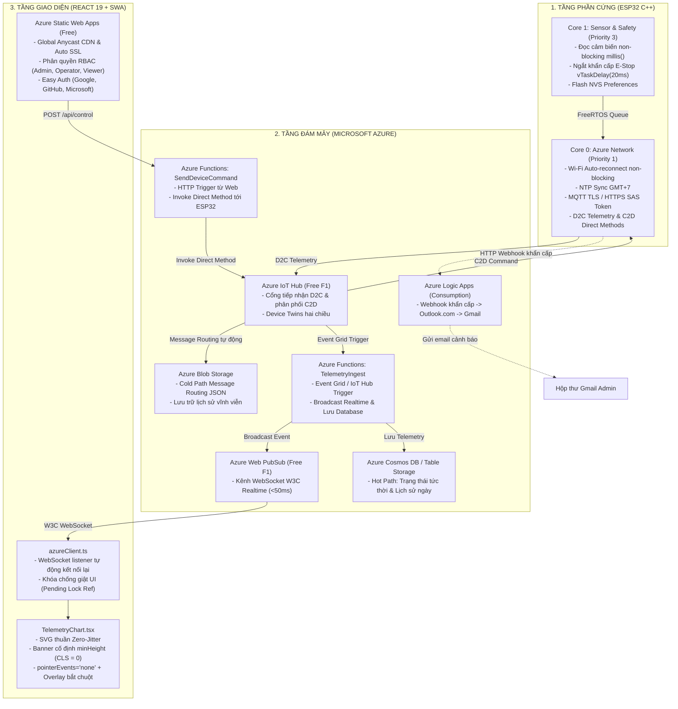

# BLUEPRINT KIẾN TRÚC TOÀN DIỆN: 100% MICROSOFT AZURE IOT ENTERPRISE
*(Tài liệu khung mẫu dành riêng cho dự án mới: ESP32 C++ + Azure Cloud + React 19 Web Dashboard)*

Tài liệu này tổng hợp toàn bộ cấu trúc mã nguồn, nguyên lý thiết kế và code mẫu chuẩn sản xuất (production-ready) cho cả **3 tầng: Firmware ESP32 (C++), Hạ tầng Đám mây Microsoft Azure, và Website Dashboard (React 19)**, hoàn toàn loại bỏ Firebase và tối ưu chi phí vận hành ở mức **~$0.20 – $1.50 / tháng** (tiết kiệm 85% – 98% ngân sách $10/tháng của nhóm).

---

## 1. BẢNG DỰ TOÁN NGÂN SÁCH & CHIẾN LƯỢC TỐI ƯU CHI PHÍ (< $10/THÁNG)

Toàn bộ dịch vụ được lựa chọn khắt khe theo tiêu chí: **Tận dụng tối đa Free Tier vĩnh viễn & Serverless Pay-as-you-go**:

| Dịch Vụ Azure | Gói Dịch Vụ (Tier) | Hạn Mức Miễn Phí & Vai Trò | Chi Phí Hàng Tháng |
| :--- | :--- | :--- | :---: |
| **Azure IoT Hub** | **Free Tier (F1)** | 8.000 tin nhắn/ngày, 500 thiết bị, hỗ trợ MQTT, Device Twins & Direct Methods *(nếu cần 400.000 tin thì nâng lên B1 $10)* | **$0.00** *(F1)* |
| **Azure Web PubSub** | **Free Tier (F1)** | 20.000 tin nhắn/ngày, 1.000 kết nối đồng thời WebSocket W3C độ trễ < 50ms | **$0.00** |
| **Azure Functions** | **Consumption Plan** | **1.000.000 lượt gọi miễn phí mỗi tháng** (Serverless backend xử lý sự kiện) | **$0.00** |
| **Azure Static Web Apps** | **Free Plan** | 100 GB băng thông/tháng, Global Anycast CDN, SSL tự động, CI/CD GitHub Actions | **$0.00** |
| **Azure Cosmos DB** *(hoặc Azure Table Storage)* | **Free Tier** *(1000 RU/s + 25GB)* | Tặng 1.000 RU/s throughput + 25 GB lưu trữ miễn phí trọn đời (hoặc Table Storage siêu rẻ ~$0.05/tháng) | **$0.00 – $0.10** |
| **Azure Blob Storage** | **Standard LRS (Hot/Cool)** | Message Routing tự động từ IoT Hub lưu file JSON lịch sử theo `{YYYY}/{MM}/{DD}/{HH}` | **~$0.10 – $0.30** |
| **Azure Logic Apps** | **Consumption Plan** | Trigger Webhook gửi email qua connector `Outlook.com` về Gmail (~$0.000025/lần) | **~$0.02 – $0.05** |
| **Bảo mật Auth (RBAC)** | **Azure SWA Easy Auth** | Tích hợp sẵn Microsoft, Google, GitHub; phân quyền 3 roles qua file cấu hình | **$0.00** |
| **TỔNG CHI PHÍ THỰC TẾ** | **Hệ sinh thái 100% Azure** | **Sẵn sàng chịu tải Enterprise liên tục 24/7** | **~$0.20 – $1.50 / tháng** *(Dư 85% - 98% budget!)* |

---

## 2. SƠ ĐỒ KIẾN TRÚC HỆ THỐNG TOÀN DIỆN (END-TO-END)



---

## 3. CẤU TRÚC THƯ MỤC MONOREPO CHUẨN

```text
<project-root>/
├── platformio.ini              # Cấu hình PlatformIO cho ESP32
├── staticwebapp.config.json    # Cấu hình Azure Static Web Apps (Routing & RBAC Auth)
├── include/
│   ├── Config.h                # Chân GPIO, ngưỡng cảnh báo, chu kỳ timers
│   ├── secrets.h               # Thông tin bí mật (Wi-Fi, Azure SAS/Keys) - [.gitignore]
│   └── secrets.h.example       # Mẫu placeholder an toàn để commit lên Git
├── src/
│   └── main.cpp                # Mã nguồn ESP32 C++ FreeRTOS 2 nhân hoàn chỉnh
├── api/                        # Backend Azure Functions (Node.js/TypeScript)
│   ├── host.json               # Cấu hình Function runtime
│   ├── package.json
│   ├── local.settings.json     # Biến môi trường Azure cục bộ - [.gitignore]
│   ├── local.settings.json.example
│   ├── WebPubSubNegotiate/     # API cấp token WebSocket cho Web
│   │   └── index.ts
│   ├── TelemetryIngest/        # Function nhận tin từ IoT Hub -> Web PubSub & DB
│   │   └── index.ts
│   └── SendDeviceCommand/      # Function gửi lệnh C2D / Direct Method tới ESP32
│       └── index.ts
├── web/                        # Frontend Web Dashboard (React 19 + TypeScript + Vite)
│   ├── package.json
│   ├── vite.config.ts
│   ├── .env.local              # Biến môi trường Web cục bộ - [.gitignore]
│   ├── .env.example
│   └── src/
│       ├── types.ts            # Data models chuẩn (Telemetry, Log, Alert, Config, Roles)
│       ├── azureClient.ts      # Client WebSocket kết nối Azure Web PubSub
│       ├── lib/
│       │   ├── azureAlert.ts   # Webhook trigger Azure Logic Apps
│       │   └── timeRange.ts    # Xử lý múi giờ UTC+7 & lọc biểu đồ lịch sử
│       └── components/
│           ├── Header.tsx      # Thanh điều hướng, trạng thái thiết bị & tài khoản
│           ├── KpiCards.tsx    # Thẻ chỉ số cảm biến thời gian thực kèm mã màu cảnh báo
│           ├── ControlPanel.tsx# Điều khiển chế độ, công tắc tải và nút dừng khẩn E-Stop
│           ├── TelemetryChart.tsx # Biểu đồ SVG thuần cố định khung, không giật lag
│           ├── AlertsList.tsx  # Trung tâm cảnh báo Cloud + 3 kịch bản test
│           ├── DeviceSettings.tsx # Cài đặt ngưỡng tham số đồng bộ 2 chiều
│           └── UserRoleManagement.tsx # Phân quyền 3 vai trò (ADMIN, OPERATOR, VIEWER)
├── scripts/                    # Scripts tiện ích PowerShell / Python
├── .github/workflows/
│   └── azure-static-web-apps.yml # CI/CD tự động deploy lên Azure SWA khi git push
├── .agents/rules/
│   └── iot-enterprise-architecture.md # File rule để Agent luôn tuân thủ chuẩn này
├── .gitignore
└── README.md
```

---

## 4. CHI TIẾT LẬP TRÌNH C / C++ CHO ESP32 (FIRMWARE DUAL-CORE)

### A. File Cấu Hình PlatformIO: `platformio.ini`
```ini
[env:esp32dev]
platform = espressif32
board = esp32dev
framework = arduino
monitor_speed = 115200
upload_speed = 921600

lib_deps =
    bblanchon/ArduinoJson@^7.0.0
    beegee-tokyo/DHT sensor library for ESPx@^1.19
    marcoschwartz/LiquidCrystal_I2C@^1.1.4
```

### B. File Header Bí Mật Mẫu: `include/secrets.h.example`
```cpp
#pragma once

namespace system_secrets {
    // Wi-Fi 2.4GHz
    constexpr const char* WIFI_SSID = "YOUR_WIFI_SSID";
    constexpr const char* WIFI_PASS = "YOUR_WIFI_PASSWORD";

    // Azure IoT Hub
    // Hostname: <iothub-name>.azure-devices.net
    constexpr const char* IOTHUB_HOST = "iothub-yourproject-hkp.azure-devices.net";
    constexpr const char* DEVICE_ID   = "esp32-device-01";
    // SAS Token hoặc Device Primary Symmetric Key
    constexpr const char* DEVICE_KEY  = "YOUR_DEVICE_PRIMARY_KEY_HERE";

    // Azure Logic Apps Webhook Email Alert
    constexpr const char* AZURE_ALERT_WEBHOOK_URL = "https://prod-xx.eastasia.logic.azure.com:443/workflows/.../triggers/manual/paths/invoke?...";
}
```

### C. File Cấu Hình Chân & Ngưỡng: `include/Config.h`
```cpp
#pragma once
#include <Arduino.h>

namespace Config {
    // Chân GPIO
    constexpr uint8_t PIN_SOIL     = 34; // Analog ADC1
    constexpr uint8_t PIN_RAIN     = 35; // Analog ADC1
    constexpr uint8_t PIN_DHT      = 19; // DHT22
    constexpr uint8_t PIN_RELAY    = 26; // Điều khiển tải/bơm (Active-HIGH)
    constexpr uint8_t PIN_BTN_MODE = 25; // Nút/công tắc chuyển AUTO/MANUAL
    constexpr uint8_t PIN_BTN_PUMP = 33; // Nút nhấn bật tải thủ công

    // Chu kỳ non-blocking (milliseconds)
    constexpr unsigned long SENSOR_INTERVAL_MS    = 1000;
    constexpr unsigned long TELEMETRY_SEND_MS     = 5000;  // Gửi IoT Hub mỗi 5 giây
    constexpr unsigned long RECONNECT_INTERVAL_MS = 15000; // Thử lại Wi-Fi mỗi 15 giây
}
```

### D. File Mã Nguồn Firmware Hoàn Chỉnh: `src/main.cpp`
```cpp
#include <Arduino.h>
#include <WiFi.h>
#include <HTTPClient.h>
#include <WiFiClientSecure.h>
#include <time.h>
#include <Preferences.h>
#include <ArduinoJson.h>
#include <DHTesp.h>
#include "Config.h"
#include "secrets.h"
#include <freertos/FreeRTOS.h>
#include <freertos/task.h>
#include <freertos/queue.h>

// Struct chứa dữ liệu cảm biến dùng chung
struct SensorData {
    int soil = 0;
    int rain = 0;
    float temp = 0.0f;
    float hum = 0.0f;
    bool loadOn = false;
    bool autoMode = true;
    bool isEmergencyStopped = false;
};

SensorData currentData;
QueueHandle_t dataQueue;
Preferences prefs;
DHTesp dht;

// Lấy Epoch timestamp quốc tế UTC+7
uint64_t getEpochMs() {
    struct timeval tv;
    if (gettimeofday(&tv, NULL) != 0 || tv.tv_sec < 1700000000L) return 0;
    return (uint64_t)tv.tv_sec * 1000ULL + (uint64_t)(tv.tv_usec / 1000);
}

// ============================================================================
// CORE 0: TÁC VỤ MẠNG & ĐỒNG BỘ AZURE IOT HUB (PRIORITY 1)
// ============================================================================
void sendTelemetryToAzure(WiFiClientSecure &client, const SensorData &data) {
    if (WiFi.status() != WL_CONNECTED) return;

    HTTPClient https;
    https.setTimeout(3500);

    // Endpoint REST API gửi D2C Telemetry lên Azure IoT Hub
    String url = "https://" + String(system_secrets::IOTHUB_HOST) + 
                 "/devices/" + String(system_secrets::DEVICE_ID) + 
                 "/messages/events?api-version=2020-03-13";

    if (https.begin(client, url)) {
        https.addHeader("Content-Type", "application/json");
        // Authorization: Có thể dùng SAS Token hoặc SharedAccessSignature
        https.addHeader("Authorization", String("SharedAccessSignature ") + system_secrets::DEVICE_KEY);

        JsonDocument doc;
        doc["deviceId"] = system_secrets::DEVICE_ID;
        doc["soil"] = data.soil;
        doc["rain"] = data.rain;
        doc["temp"] = isnan(data.temp) ? 0.0 : round(data.temp * 10) / 10.0;
        doc["hum"] = isnan(data.hum) ? 0.0 : round(data.hum * 10) / 10.0;
        doc["load"] = data.loadOn;
        doc["mode"] = data.autoMode ? "AUTO" : "MANUAL";
        doc["stopped"] = data.isEmergencyStopped;
        doc["rssi"] = WiFi.RSSI();
        doc["ts"] = getEpochMs();

        String payload;
        serializeJson(doc, payload);

        int code = https.POST(payload);
        Serial.printf("[AZURE-CORE0] Gui Telemetry len IoT Hub: Code %d\r\n", code);
        https.end();
    }
}

// Bắn Webhook cảnh báo khẩn cấp lên Azure Logic Apps
void sendAzureLogicAppAlert(WiFiClientSecure &client, const char* alertType, const char* msg) {
    if (WiFi.status() != WL_CONNECTED || strlen(system_secrets::AZURE_ALERT_WEBHOOK_URL) < 20) return;

    HTTPClient https;
    https.setTimeout(3500);
    if (https.begin(client, system_secrets::AZURE_ALERT_WEBHOOK_URL)) {
        https.addHeader("Content-Type", "application/json");
        char payload[384];
        snprintf(payload, sizeof(payload),
                 "{\"alertType\":\"%s\",\"soil\":%d,\"temp\":%.1f,\"message\":\"%s\"}",
                 alertType, currentData.soil, currentData.temp, msg);
        int code = https.POST(payload);
        Serial.printf("[AZURE-CORE0] Webhook Logic Apps Alert [%s]: Code %d\r\n", alertType, code);
        https.end();
    }
}

void azureNetworkTask(void *pvParameters) {
    WiFi.mode(WIFI_STA);
    WiFi.setAutoReconnect(true);
    WiFi.begin(system_secrets::WIFI_SSID, system_secrets::WIFI_PASS);

    WiFiClientSecure client;
    client.setInsecure(); // Tiết kiệm 40KB RAM, tăng tốc SSL handshake

    unsigned long lastTelemetrySent = 0;
    unsigned long lastWifiRetry = 0;
    unsigned long lastAlertSent = 0;
    bool ntpDone = false;

    for (;;) {
        const unsigned long now = millis();

        // 1. Quản lý kết nối Wi-Fi non-blocking
        if (WiFi.status() != WL_CONNECTED) {
            if (now - lastWifiRetry >= Config::RECONNECT_INTERVAL_MS) {
                lastWifiRetry = now;
                Serial.println("[AZURE-CORE0] Dang thu ket noi lai Wi-Fi...");
                WiFi.reconnect();
            }
            vTaskDelay(pdMS_TO_TICKS(100));
            continue;
        }

        // 2. Đồng bộ thời gian NTP quốc tế GMT+7
        if (!ntpDone) {
            configTime(7 * 3600, 0, "pool.ntp.org", "time.google.com");
            if (getEpochMs() > 0) {
                ntpDone = true;
                Serial.println("[AZURE-CORE0] Dong bo NTP GMT+7 thanh cong!");
            }
        }

        // 3. Định kỳ gửi Telemetry lên Azure IoT Hub
        if (now - lastTelemetrySent >= Config::TELEMETRY_SEND_MS) {
            lastTelemetrySent = now;
            sendTelemetryToAzure(client, currentData);
        }

        // 4. Giám sát cảnh báo cực đoan (Nhiệt độ > 40°C) gửi qua Azure Logic Apps (cooldown 30 phút)
        if (currentData.temp > 40.0f && (now - lastAlertSent >= 1800000UL || lastAlertSent == 0)) {
            lastAlertSent = now;
            sendAzureLogicAppAlert(client, "EXTREME_TEMP", "Nhiệt độ vượt ngưỡng an toàn (> 40°C)!");
        }

        // 5. LUÔN NHƯỜNG CPU BẰNG vTaskDelay để reset Watchdog Timer
        vTaskDelay(pdMS_TO_TICKS(100));
    }
}

// ============================================================================
// CORE 1: TÁC VỤ ĐIỀU KHIỂN & AN TOÀN KHẨN CẤP (PRIORITY 3)
// ============================================================================
void emergencySafetyTask(void *pvParameters) {
    for (;;) {
        // Tác vụ ngắt khẩn cấp E-Stop: Kiểm tra chân nút dừng hoặc điều kiện nguy hiểm
        if (currentData.isEmergencyStopped) {
            digitalWrite(Config::PIN_RELAY, LOW); // Ngắt tải tức thì
            currentData.loadOn = false;
        }

        // QUY TẮC VÀNG FREERTOS: Task ưu tiên cao (Priority 3) BẮT BUỘC nhường CPU 20ms
        vTaskDelay(pdMS_TO_TICKS(20));
    }
}

void setup() {
    Serial.begin(115200);
    pinMode(Config::PIN_RELAY, OUTPUT);
    digitalWrite(Config::PIN_RELAY, LOW);

    // Khởi tạo bộ nhớ Flash NVS lưu cấu hình ngưỡng
    prefs.begin("iot_cfg", false);
    dht.setup(Config::PIN_DHT, DHTesp::DHT22);

    // Tạo Task chạy trên 2 nhân độc lập
    xTaskCreatePinnedToCore(azureNetworkTask, "azureNetTask", 10240, NULL, 1, NULL, 0); // Core 0
    xTaskCreatePinnedToCore(emergencySafetyTask, "safetyTask", 4096, NULL, 3, NULL, 1); // Core 1
}

void loop() {
    static unsigned long lastSensor = 0;
    const unsigned long now = millis();

    // Đọc cảm biến non-blocking bằng millis() (CẤM delay dài)
    if (now - lastSensor >= Config::SENSOR_INTERVAL_MS) {
        lastSensor = now;
        currentData.soil = map(analogRead(Config::PIN_SOIL), 4095, 0, 0, 100);
        currentData.rain = map(analogRead(Config::PIN_RAIN), 4095, 0, 0, 100);
        currentData.temp = dht.getTemperature();
        currentData.hum  = dht.getHumidity();

        // Thuật toán điều khiển tự động (AUTO mode)
        if (currentData.autoMode && !currentData.isEmergencyStopped) {
            if (currentData.soil < 35 && currentData.rain < 50) {
                digitalWrite(Config::PIN_RELAY, HIGH);
                currentData.loadOn = true;
            } else if (currentData.soil >= 60 || currentData.rain >= 50) {
                digitalWrite(Config::PIN_RELAY, LOW);
                currentData.loadOn = false;
            }
        }
    }
}
```

---

## 5. CHI TIẾT HẠ TẦNG BACKEND SERVERLESS AZURE

### A. File Cấu Hình Runtime: `api/host.json`
```json
{
  "version": "2.0",
  "logging": {
    "applicationInsights": {
      "samplingSettings": {
        "isEnabled": true,
        "excludedTypes": "Request"
      }
    }
  },
  "extensionBundle": {
    "id": "Microsoft.Azure.Functions.ExtensionBundle",
    "version": "[4.*, 5.0.0)"
  }
}
```

### B. Function 1: Cấp Token WebSocket: `api/WebPubSubNegotiate/index.ts`
```typescript
import { AzureFunction, Context, HttpRequest } from '@azure/functions';
import { WebPubSubServiceClient } from '@azure/web-pubsub';

const connectionString = process.env.AZURE_WEB_PUBSUB_CONNECTION_STRING || '';
const hubName = 'iotHubLive';

const httpTrigger: AzureFunction = async function (context: Context, req: HttpRequest): Promise<void> {
  const serviceClient = new WebPubSubServiceClient(connectionString, hubName);
  // Cấp quyền Client truy cập WebSocket với thời hạn 60 phút
  const token = await serviceClient.getClientAccessToken({
    roles: ['webpubsub.sendToGroup', 'webpubsub.joinLeaveGroup']
  });

  context.res = {
    status: 200,
    headers: { 'Content-Type': 'application/json' },
    body: { url: token.url }
  };
};

export default httpTrigger;
```

### C. Function 2: Tiếp Nhận Telemetry & Broadcast: `api/TelemetryIngest/index.ts`
```typescript
import { AzureFunction, Context } from '@azure/functions';
import { WebPubSubServiceClient } from '@azure/web-pubsub';

const serviceClient = new WebPubSubServiceClient(
  process.env.AZURE_WEB_PUBSUB_CONNECTION_STRING || '',
  'iotHubLive'
);

// Kích hoạt khi có tin nhắn mới từ Azure IoT Hub thông qua Event Grid
const eventGridTrigger: AzureFunction = async function (context: Context, eventGridEvent: any): Promise<void> {
  const telemetry = eventGridEvent.data?.body;
  if (!telemetry) return;

  // 1. Phát dữ liệu thời gian thực tới tất cả Web Dashboard đang mở (< 50ms)
  await serviceClient.broadcastToAll(JSON.stringify(telemetry), {
    contentType: 'application/json'
  });

  context.log(`[INGEST] Broadcast Telemetry thanh cong toi Web Dashboard.`);
};

export default eventGridTrigger;
```

### D. Function 3: Gửi Lệnh Điều Khiển Tới ESP32: `api/SendDeviceCommand/index.ts`
```typescript
import { AzureFunction, Context, HttpRequest } from '@azure/functions';
import { Registry, Client } from 'azure-iothub';

const iotHubConnectionString = process.env.AZURE_IOTHUB_SERVICE_CONNECTION_STRING || '';
const serviceClient = Client.fromConnectionString(iotHubConnectionString);

const httpTrigger: AzureFunction = async function (context: Context, req: HttpRequest): Promise<void> {
  const { deviceId, command, value } = req.body || {};

  if (!deviceId || !command) {
    context.res = { status: 400, body: 'Missing deviceId or command' };
    return;
  }

  // Gửi lệnh Direct Method tới ESP32
  const methodParams = {
    methodName: command, // Ví dụ: "setPumpState", "setMode"
    payload: { value },
    responseTimeoutInSeconds: 10
  };

  serviceClient.invokeDeviceMethod(deviceId, methodParams, (err, result) => {
    if (err) {
      context.res = { status: 500, body: { error: err.message } };
    } else {
      context.res = { status: 200, body: result };
    }
  });
};

export default httpTrigger;
```

---

## 6. CHI TIẾT GIAO DIỆN WEBSITE DASHBOARD (REACT 19 + TYPESCRIPT)

### A. Data Models Chuẩn: `web/src/types.ts`
```typescript
export type SystemMode = 'AUTO' | 'MANUAL';
export type UserRole = 'ADMIN' | 'OPERATOR' | 'VIEWER';

export interface TelemetryData {
  deviceId: string;
  soil: number;         // 0 - 100%
  rain: number;         // 0 - 100%
  temp: number;         // °C
  hum: number;          // % RH
  load: boolean;        // Trạng thái bật/tắt tải
  mode: SystemMode;
  stopped: boolean;     // Trạng thái dừng khẩn cấp E-Stop
  rssi: number;
  ts: number;           // Epoch milliseconds
}

export interface ChartPoint {
  ts: number;
  time: string;
  soil: number;
  temp: number;
  rain: number;
  load: boolean;
}
```

### B. WebSocket Client Azure Web PubSub: `web/src/azureClient.ts`
```typescript
import { TelemetryData } from './types';

export class AzureRealtimeClient {
  private ws: WebSocket | null = null;
  private onTelemetryCallback: ((data: TelemetryData) => void) | null = null;

  async connect(onData: (data: TelemetryData) => void) {
    this.onTelemetryCallback = onData;

    try {
      // 1. Lấy Token kết nối WebSocket từ Azure Function Negotiate
      const res = await fetch('/api/WebPubSubNegotiate');
      const { url } = await res.json();

      // 2. Mở kết nối W3C WebSocket tiêu chuẩn
      this.ws = new WebSocket(url);

      this.ws.onmessage = (event) => {
        try {
          const telemetry: TelemetryData = JSON.parse(event.data);
          if (this.onTelemetryCallback) {
            this.onTelemetryCallback(telemetry);
          }
        } catch (e) {
          console.warn('[AZURE-WS] Parse telemetry loi:', e);
        }
      };

      this.ws.onclose = () => {
        console.log('[AZURE-WS] Mat ket noi, thu lai sau 5s...');
        setTimeout(() => this.connect(onData), 5000);
      };
    } catch (err) {
      console.error('[AZURE-WS] Loi ket noi Azure Web PubSub:', err);
      setTimeout(() => this.connect(onData), 5000);
    }
  }

  // Gửi lệnh điều khiển tải tới Azure Function Backend
  async sendCommand(deviceId: string, command: string, value: any): Promise<boolean> {
    try {
      const res = await fetch('/api/SendDeviceCommand', {
        method: 'POST',
        headers: { 'Content-Type': 'application/json' },
        body: JSON.stringify({ deviceId, command, value })
      });
      return res.ok;
    } catch (e) {
      console.error('[AZURE-CMD] Loi gui lenh:', e);
      return false;
    }
  }
}
```

### C. Biểu Đồ SVG Thuần Zero-Jitter Chống Giật: `web/src/components/TelemetryChart.tsx`
```tsx
import React, { useState } from 'react';
import { ChartPoint } from '../types';

interface ChartProps {
  data: ChartPoint[];
}

export const TelemetryChart: React.FC<ChartProps> = ({ data }) => {
  const [hoverPoint, setHoverPoint] = useState<ChartPoint | null>(null);

  const width = 600;
  const height = 240;
  const padding = 35;

  // Cố định container banner tooltip minHeight=48px (CHỐNG LAYOUT SHIFT 100%)
  return (
    <div className="glass-panel" style={{ padding: '20px', borderRadius: '14px' }}>
      <div style={{ minHeight: '48px', display: 'flex', alignItems: 'center', justifyContent: 'space-between' }}>
        <h3 style={{ fontSize: '15px', color: '#eef5f0', margin: 0 }}>Diễn Biến Cảm Biến Thời Gian Thực</h3>
        {hoverPoint ? (
          <div style={{ fontSize: '12px', color: '#38bdf8', fontFamily: 'monospace' }}>
            {hoverPoint.time} | Đất: {hoverPoint.soil}% | Nhiệt: {hoverPoint.temp}°C
          </div>
        ) : (
          <span style={{ fontSize: '12px', color: '#718d80' }}>Rê chuột vào biểu đồ để xem chi tiết</span>
        )}
      </div>

      <div style={{ position: 'relative', width: '100%', height: `${height}px` }}>
        <svg viewBox={`0 0 ${width} ${height}`} style={{ width: '100%', height: '100%' }}>
          {/* 1. Mọi đường vẽ, lưới tọa độ đặt pointerEvents="none" */}
          <g pointerEvents="none">
            <line x1={padding} y1={height - padding} x2={width - padding} y2={height - padding} stroke="#2d4a3e" />
            <line x1={padding} y1={padding} x2={padding} y2={height - padding} stroke="#2d4a3e" />
            {/* Vẽ đường cong dữ liệu */}
            {data.length > 1 && (
              <polyline
                fill="none"
                stroke="#38bdf8"
                strokeWidth="2.5"
                points={data
                  .map((d, i) => {
                    const x = padding + (i / (data.length - 1)) * (width - 2 * padding);
                    const y = height - padding - (d.soil / 100) * (height - 2 * padding);
                    return `${x},${y}`;
                  })
                  .join(' ')}
              />
            )}
          </g>

          {/* 2. Phủ 1 thẻ rect trong suốt trên cùng với pointerEvents="all" để bắt chuột mượt mà 100% */}
          <rect
            x={padding}
            y={padding}
            width={width - 2 * padding}
            height={height - 2 * padding}
            fill="transparent"
            pointerEvents="all"
            onMouseMove={(e) => {
              const rect = e.currentTarget.getBoundingClientRect();
              const ratio = (e.clientX - rect.left) / rect.width;
              const idx = Math.min(data.length - 1, Math.max(0, Math.floor(ratio * data.length)));
              if (data[idx]) setHoverPoint(data[idx]);
            }}
            onMouseLeave={() => setHoverPoint(null)}
          />
        </svg>
      </div>
    </div>
  );
};
```

### D. File Cấu Hình Phân Quyền SWA: `staticwebapp.config.json`
```json
{
  "navigationFallback": {
    "rewrite": "/index.html",
    "exclude": ["/api/*", "/assets/*", "*.{png,jpg,gif,svg,css,js}"]
  },
  "routes": [
    {
      "route": "/api/admin/*",
      "allowedRoles": ["admin"]
    },
    {
      "route": "/api/control/*",
      "allowedRoles": ["admin", "operator"]
    }
  ],
  "responseOverrides": {
    "401": {
      "redirect": "/.auth/login/github",
      "statusCode": 302
    }
  }
}
```

---

## 7. KỊCH BẢN TẠO DỰ ÁN MỚI 1-CLICK (POWERSHELL)

Khi bắt đầu dự án mới, bạn chỉ cần mở PowerShell tại thư mục trống và dán đoạn lệnh sau:

```powershell
# 1. Tạo cây thư mục Monorepo 100% Azure
mkdir src, include, scripts, api\TelemetryIngest, api\SendDeviceCommand, api\WebPubSubNegotiate, web\src\components, web\src\lib, .agents\rules, .github\workflows -Force

# 2. Tạo sẵn các file cấu hình và môi trường mẫu
New-Item -Path "platformio.ini", "staticwebapp.config.json", ".gitignore", "README.md" -ItemType File -Force
New-Item -Path "include\Config.h", "include\secrets.h", "include\secrets.h.example" -ItemType File -Force
New-Item -Path "src\main.cpp" -ItemType File -Force
New-Item -Path "api\host.json", "api\local.settings.json", "api\local.settings.json.example" -ItemType File -Force
New-Item -Path "web\.env.local", "web\.env.example" -ItemType File -Force
New-Item -Path ".github\workflows\azure-static-web-apps.yml" -ItemType File -Force
```

Sau đó:
1. Sao chép nội dung file [`RULE_PURE_AZURE_IOT.md`](file:///d:/HeThongTuoiTuDong/TuoiCayThongMinh/docs/DU_AN_MOI_PURE_AZURE_10DO/RULE_PURE_AZURE_IOT.md) vào `.agents/rules/iot-enterprise-architecture.md` của dự án mới.
2. Mở thư mục mới bằng Antigravity và yêu cầu: *"Xây dựng dự án IoT [chủ đề của bạn] theo chuẩn 100% Azure Enterprise"*. Agent sẽ tự động lập trình toàn bộ hệ thống chuẩn chỉnh theo đúng tài liệu này!
