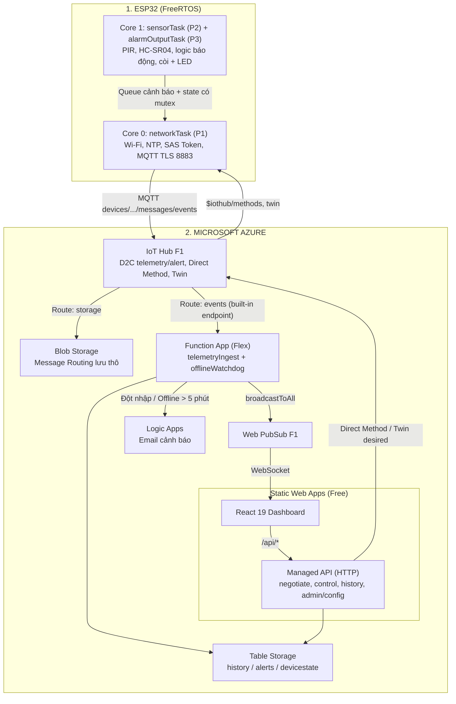

# BLUEPRINT KIẾN TRÚC: HỆ THỐNG CẢNH BÁO CHỐNG TRỘM IOT — 100% MICROSOFT AZURE
*(Đề tài 02 — ESP32 C++ + Azure IoT Hub + Azure Functions + React 19 Web Dashboard trên Azure Static Web Apps)*

Tài liệu này mô tả toàn bộ cấu trúc mã nguồn, nguyên lý thiết kế và code mẫu cho cả **3 tầng: Firmware ESP32, Hạ tầng Microsoft Azure, Website Dashboard (React 19 + TypeScript + Vite)** của hệ thống chống trộm, bám sát bộ linh kiện trong [`BANG_TONG_HOP_DON_HANG.md`](BANG_TONG_HOP_DON_HANG.md).

> **Phiên bản 2.0 (31/10/2026)** — Viết lại từ bản mẫu của dự án tưới cây. Xem [Mục 11 – Nhật ký sửa lỗi](#11-nhật-ký-sửa-lỗi-so-với-bản-cũ) để biết các điểm sai đã được sửa.

---

## 1. YÊU CẦU ĐỀ TÀI & BỘ LINH KIỆN

| Tiêu chí rubric | Đáp ứng |
| :--- | :--- |
| Dùng ESP32 | Kit ESP32 NodeMCU LuaNode32 30 chân Type-C (`esp32doit-devkit-v1`) |
| ≥ 2 cảm biến thực | **PIR HC-SR501** (phát hiện chuyển động) + **HC-SR04** (đo khoảng cách, vẽ biểu đồ) |
| ≥ 2 thiết bị ra | **Buzzer 3V** + **LED Vàng** (báo động) + **LED Xanh** (trạng thái ARM) |
| Điều khiển từ xa | Bật/tắt bảo vệ **ARM / DISARM**, **tắt còi** từ Web qua Azure IoT Hub (Direct Method) |
| Cảnh báo | Phát hiện đột nhập → cập nhật realtime lên Web + gửi **email** qua Azure Logic Apps |
| Dashboard + biểu đồ lịch sử | Biểu đồ khoảng cách Sonar theo thời gian, nhật ký cảnh báo |
| Mô phỏng Wokwi | `board-esp32-devkit-c-v4`, `wokwi-pir-motion-sensor`, `wokwi-hc-sr04`, `wokwi-buzzer`, `wokwi-led` |

### Sơ đồ chân chuẩn (ESP32)

| Thiết bị | Chân module | Chân ESP32 | Ghi chú |
| :--- | :--- | :--- | :--- |
| PIR HC-SR501 | VCC / GND / OUT | VIN (5V) / GND / **GPIO 13** | OUT mức 3.3V, cắm trực tiếp. Cần chờ ~30–60 giây sau khi cấp nguồn để cảm biến ổn định |
| HC-SR04 | VCC / GND / TRIG / ECHO | VIN (5V) / GND / **GPIO 5** / **GPIO 18** | **ECHO ra 5V → bắt buộc qua cầu chia áp 1kΩ/2kΩ** (≈3.3V) |
| Buzzer 3V | + / − | **GPIO 23** / GND | ⚠️ Không dùng GPIO 12 (chân strapping, có thể làm ESP32 không khởi động được) |
| LED Vàng (báo động) | Anode → 220Ω | **GPIO 2** | Nhấp nháy khi đang báo động |
| LED Xanh (ARM) | Anode → 220Ω | **GPIO 4** | Sáng khi đang bật bảo vệ |

---

## 2. BẢNG DỰ TOÁN CHI PHÍ AZURE (< $10/THÁNG)

| Dịch vụ Azure | Gói | Hạn mức & vai trò | Chi phí/tháng |
| :--- | :--- | :--- | :---: |
| **Azure IoT Hub** | **Free F1** | 8.000 tin nhắn/ngày (khối 0,5 KB), 500 thiết bị, MQTT, Device Twin, Direct Method | **$0.00** |
| **Azure Web PubSub** | **Free F1** | 20.000 tin nhắn/ngày, **tối đa 20 kết nối đồng thời** | **$0.00** |
| **Azure Functions** (Ingest) | **Flex Consumption** | Hạn mức miễn phí hàng tháng; chạy trigger IoT Hub và Timer | **~$0.00** |
| **Azure Static Web Apps** | **Free** | Hosting React, Managed Functions (chỉ HTTP), Easy Auth (Entra ID / GitHub), custom roles qua lời mời | **$0.00** |
| **Azure Storage Account** | **Standard LRS** | Table Storage (lịch sử, cảnh báo, trạng thái) + Blob (lưu trữ thô) + storage của Function | **~$0.05 – $0.30** |
| **Azure Logic Apps** | **Consumption** | Webhook → Outlook.com gửi email cảnh báo | **~$0.01 – $0.05** |
| **TỔNG** | | | **~$0.10 – $0.50** |

> ⚠️ **Ngân sách tin nhắn IoT Hub F1:** Gửi telemetry mỗi **15 giây** = 5.760 tin/ngày, còn dư ~2.000 tin cho cảnh báo, Direct Method và Twin. **Không gửi mỗi 5 giây** (17.280 tin/ngày → vượt hạn mức, IoT Hub sẽ từ chối tin nhắn đến hết ngày).
>
> ⚠️ **Không dùng IoT Hub Basic (B1):** gói Basic **không hỗ trợ** Direct Method, Device Twin và Cloud-to-Device, nên không điều khiển ARM/DISARM được. Nếu cần nâng cấp thì chọn **S1**.

---

## 3. SƠ ĐỒ KIẾN TRÚC END-TO-END



**Điểm thiết kế quan trọng:**
- **ESP32 dùng MQTT, không dùng HTTPS REST**: thiết bị dùng HTTPS **không nhận được Direct Method** và phải poll C2D. MQTT giữ kết nối hai chiều nên lệnh ARM/DISARM đến thiết bị trong < 1 giây.
- **Hai nơi chạy Functions**: Managed Functions của SWA Free **chỉ hỗ trợ HTTP trigger**, nên trigger IoT Hub và Timer phải chạy trong một **Function App riêng (Flex Consumption)**. Các API HTTP mà web gọi thì đặt trong SWA để dùng chung đăng nhập và phân quyền.
- **Secret Logic Apps không nằm trên ESP32**: email do Function gửi, thiết bị chỉ cần khóa IoT Hub.
- **Phát hiện offline chạy trên cloud** (Timer Function), không phụ thuộc việc có trình duyệt nào đang mở.

---

## 4. CẤU TRÚC THƯ MỤC MONOREPO

```text
HeThongTrongTrom/
├── platformio.ini                  # ESP32 DevKit V1 + PubSubClient + ArduinoJson
├── wokwi.toml / diagram.json       # Mô phỏng Wokwi trong VS Code
├── include/
│   ├── Config.h                    # Chân GPIO, ngưỡng, chu kỳ timer
│   ├── secrets.h                   # Wi-Fi + IoT Hub device key  [.gitignore]
│   └── secrets.h.example
├── src/
│   └── main.cpp                    # Firmware FreeRTOS 2 nhân
├── functions-ingest/               # Function App riêng (Flex Consumption)
│   ├── host.json
│   ├── package.json
│   ├── local.settings.json         # [.gitignore]
│   └── src/functions/
│       ├── telemetryIngest.ts      # IoT Hub (Event Hub-compatible) trigger
│       └── offlineWatchdog.ts      # Timer trigger mỗi 1 phút
├── api/                            # SWA Managed Functions (HTTP)
│   ├── host.json
│   ├── package.json
│   └── src/
│       ├── lib/auth.ts             # Đọc x-ms-client-principal, kiểm tra role
│       └── functions/
│           ├── negotiate.ts        # GET  /api/realtime/negotiate
│           ├── controlCommand.ts   # POST /api/control/command   (admin, operator)
│           ├── history.ts          # GET  /api/history, /api/alerts
│           └── adminConfig.ts      # PUT  /api/admin/config      (admin)
├── web/                            # React 19 + TypeScript + Vite
│   ├── package.json
│   ├── vite.config.ts
│   ├── staticwebapp.config.json    # Routing, RBAC, security headers
│   └── src/
│       ├── types.ts
│       ├── azureClient.ts          # Web PubSub WebSocket + REST
│       ├── lib/auth.ts             # /.auth/me
│       ├── lib/timeRange.ts        # Múi giờ UTC+7
│       └── components/
│           ├── Header.tsx          # Trạng thái online, tài khoản
│           ├── KpiCards.tsx        # ARM, báo động, PIR, khoảng cách
│           ├── ControlPanel.tsx    # ARM/DISARM, tắt còi (pending lock)
│           ├── DistanceChart.tsx   # Biểu đồ SVG khoảng cách (zero-jitter)
│           ├── AlertsList.tsx      # Nhật ký đột nhập
│           ├── DeviceSettings.tsx  # Ngưỡng khoảng cách (Twin desired)
│           └── UserRoleInfo.tsx    # Hiển thị vai trò hiện tại
├── scripts/provision-azure.ps1     # Tạo tài nguyên Azure bằng az CLI
├── .github/workflows/
│   ├── azure-static-web-apps.yml   # Deploy web + api
│   └── functions-ingest.yml        # Deploy Function App
├── .gitignore
└── README.md
```

---

## 5. FIRMWARE ESP32 (C++ / FREERTOS)

### A. `platformio.ini`
```ini
[env:esp32doit-devkit-v1]
platform = espressif32
board = esp32doit-devkit-v1
framework = arduino
monitor_speed = 115200
upload_speed = 921600

lib_deps =
    knolleary/PubSubClient@^2.8
    bblanchon/ArduinoJson@^7.0.0

build_flags =
    -D MQTT_MAX_PACKET_SIZE=1024
```

### B. `include/secrets.h.example`
```cpp
#pragma once
// Sao chép thành secrets.h rồi điền giá trị thật. secrets.h đã được .gitignore chặn.
namespace system_secrets {
    constexpr const char* WIFI_SSID   = "YOUR_WIFI_SSID";       // Wi-Fi 2.4 GHz
    constexpr const char* WIFI_PASS   = "YOUR_WIFI_PASSWORD";

    // az iot hub device-identity create --hub-name <hub> -d esp32-chongtrom-01
    constexpr const char* IOTHUB_HOST = "<iothub-name>.azure-devices.net";
    constexpr const char* DEVICE_ID   = "esp32-chongtrom-01";
    // Primary key (Base64) của device — KHÔNG phải SAS token, firmware tự sinh token
    constexpr const char* DEVICE_KEY  = "YOUR_DEVICE_PRIMARY_KEY_BASE64";
}
```

### C. `include/Config.h`
```cpp
#pragma once
#include <Arduino.h>

namespace Config {
    // Chân GPIO
    constexpr uint8_t PIN_PIR       = 13;
    constexpr uint8_t PIN_US_TRIG   = 5;
    constexpr uint8_t PIN_US_ECHO   = 18;   // Qua cầu chia áp 1k/2k
    constexpr uint8_t PIN_BUZZER    = 23;   // KHÔNG dùng GPIO 12 (strapping)
    constexpr uint8_t PIN_LED_ALARM = 2;    // LED Vàng
    constexpr uint8_t PIN_LED_ARMED = 4;    // LED Xanh

    // Ngưỡng & thời gian
    constexpr uint16_t DEFAULT_DISTANCE_THRESHOLD_CM = 50;   // Vật thể gần hơn → đột nhập
    constexpr uint16_t MIN_THRESHOLD_CM = 5, MAX_THRESHOLD_CM = 400;
    constexpr uint32_t PIR_WARMUP_MS          = 30000;   // Bỏ qua PIR 30 giây đầu
    constexpr uint32_t ALARM_AUTO_SILENCE_MS  = 60000;   // Tự tắt còi sau 60 giây
    constexpr uint32_t SENSOR_INTERVAL_MS     = 200;
    constexpr uint32_t TELEMETRY_INTERVAL_MS  = 15000;   // 5.760 tin/ngày (nằm trong F1)
    constexpr uint32_t WIFI_RETRY_MS          = 15000;
    constexpr uint32_t MQTT_RETRY_MS          = 10000;
    constexpr uint32_t SAS_TTL_S              = 3600;    // Token 60 phút, tự gia hạn
}
```

### D. `src/main.cpp`
```cpp
#include <Arduino.h>
#include <WiFi.h>
#include <WiFiClientSecure.h>
#include <PubSubClient.h>
#include <ArduinoJson.h>
#include <Preferences.h>
#include <time.h>
#include <mbedtls/md.h>
#include <mbedtls/base64.h>
#include "Config.h"
#include "secrets.h"

using namespace system_secrets;

// ---------------------------------------------------------------------------
// Trạng thái dùng chung giữa 2 nhân — luôn truy cập trong critical section
// ---------------------------------------------------------------------------
struct SharedState {
    bool     armed = false;
    bool     alarm = false;
    bool     pir = false;
    float    distanceCm = -1.0f;
    uint32_t alarmSinceMs = 0;
    uint16_t thresholdCm = Config::DEFAULT_DISTANCE_THRESHOLD_CM;
};

struct AlertEvent {
    char  sensor[8];     // "PIR" | "SONAR"
    float distanceCm;
};

static SharedState   g;
static portMUX_TYPE  gMux = portMUX_INITIALIZER_UNLOCKED;
static QueueHandle_t alertQueue;
static Preferences   prefs;
static volatile bool reportPending = true;   // Cần gửi reported twin

static WiFiClientSecure tls;
static PubSubClient     mqtt(tls);
static time_t           sasExpiry = 0;

static SharedState snapshot() {
    portENTER_CRITICAL(&gMux);
    SharedState s = g;
    portEXIT_CRITICAL(&gMux);
    return s;
}

// Thời gian epoch UTC (ms). configTime(+7h) chỉ ảnh hưởng localtime, epoch vẫn là UTC.
static uint64_t epochMs() {
    struct timeval tv;
    gettimeofday(&tv, nullptr);
    if (tv.tv_sec < 1700000000L) return 0;   // Chưa đồng bộ NTP
    return (uint64_t)tv.tv_sec * 1000ULL + tv.tv_usec / 1000;
}

// ---------------------------------------------------------------------------
// Lệnh điều khiển (gọi từ Core 0 khi nhận Direct Method / Twin)
// ---------------------------------------------------------------------------
static void setArmed(bool armed) {
    portENTER_CRITICAL(&gMux);
    g.armed = armed;
    if (!armed) g.alarm = false;            // DISARM luôn tắt còi
    portEXIT_CRITICAL(&gMux);
    prefs.putBool("armed", armed);          // Giữ trạng thái khi mất điện
    reportPending = true;
}

static void silenceAlarm() {
    portENTER_CRITICAL(&gMux);
    g.alarm = false;
    portEXIT_CRITICAL(&gMux);
    reportPending = true;
}

static void setThreshold(int cm) {
    cm = constrain(cm, Config::MIN_THRESHOLD_CM, Config::MAX_THRESHOLD_CM);
    portENTER_CRITICAL(&gMux);
    g.thresholdCm = (uint16_t)cm;
    portEXIT_CRITICAL(&gMux);
    prefs.putUShort("thr", (uint16_t)cm);
    reportPending = true;
}

// ===========================================================================
// CORE 1 — CẢM BIẾN & LOGIC BÁO ĐỘNG (Priority 2)
// ===========================================================================
static float readDistanceCm() {
    digitalWrite(Config::PIN_US_TRIG, LOW);
    delayMicroseconds(2);
    digitalWrite(Config::PIN_US_TRIG, HIGH);
    delayMicroseconds(10);
    digitalWrite(Config::PIN_US_TRIG, LOW);
    // Timeout 25 ms (~4 m). Đây là chờ ngắn có giới hạn, không phải delay() dài.
    const unsigned long us = pulseIn(Config::PIN_US_ECHO, HIGH, 25000UL);
    return us == 0 ? -1.0f : us * 0.0343f / 2.0f;
}

static void sensorTask(void*) {
    TickType_t last = xTaskGetTickCount();
    for (;;) {
        const bool  pir  = digitalRead(Config::PIN_PIR) == HIGH;
        const float d    = readDistanceCm();
        const bool  warm = millis() > Config::PIR_WARMUP_MS;
        const char* src  = nullptr;

        portENTER_CRITICAL(&gMux);
        g.pir = pir;
        g.distanceCm = d;
        if (g.armed && !g.alarm && warm) {
            if (pir)                                src = "PIR";
            else if (d > 0 && d < g.thresholdCm)    src = "SONAR";
            if (src) { g.alarm = true; g.alarmSinceMs = millis(); }
        }
        if (g.alarm && millis() - g.alarmSinceMs >= Config::ALARM_AUTO_SILENCE_MS) {
            g.alarm = false;                        // Tự tắt còi sau 60 giây
        }
        portEXIT_CRITICAL(&gMux);

        if (src) {
            AlertEvent ev{};
            strlcpy(ev.sensor, src, sizeof(ev.sensor));
            ev.distanceCm = d;
            xQueueSend(alertQueue, &ev, 0);         // Không block nếu queue đầy
        }
        vTaskDelayUntil(&last, pdMS_TO_TICKS(Config::SENSOR_INTERVAL_MS));
    }
}

// ===========================================================================
// CORE 1 — ĐIỀU KHIỂN CÒI + LED (Priority 3, ưu tiên cao nhất)
// Chạy độc lập với mạng: mất Wi-Fi vẫn báo động tại chỗ.
// ===========================================================================
static void alarmOutputTask(void*) {
    for (;;) {
        const SharedState s = snapshot();
        digitalWrite(Config::PIN_LED_ARMED, s.armed ? HIGH : LOW);
        if (s.alarm) {
            const bool on = (millis() / 250) % 2;   // Nhấp nháy 2 Hz
            digitalWrite(Config::PIN_LED_ALARM, on);
            digitalWrite(Config::PIN_BUZZER, on);
        } else {
            digitalWrite(Config::PIN_LED_ALARM, LOW);
            digitalWrite(Config::PIN_BUZZER, LOW);
        }
        vTaskDelay(pdMS_TO_TICKS(20));              // BẮT BUỘC nhường CPU
    }
}

// ===========================================================================
// CORE 0 — WI-FI, NTP, AZURE IOT HUB MQTT (Priority 1)
// ===========================================================================
static String urlEncode(const String& s) {
    static const char* hex = "0123456789ABCDEF";
    String out;
    for (size_t i = 0; i < s.length(); i++) {
        const char c = s[i];
        if (isalnum((unsigned char)c) || c == '-' || c == '_' || c == '.' || c == '~') out += c;
        else { out += '%'; out += hex[(c >> 4) & 0xF]; out += hex[c & 0xF]; }
    }
    return out;
}

// SAS = HMAC-SHA256(Base64Decode(deviceKey), urlencode(resourceUri) + "\n" + expiry)
static String generateSasToken(time_t expiry) {
    const String sr = urlEncode(String(IOTHUB_HOST) + "/devices/" + DEVICE_ID);
    const String toSign = sr + "\n" + String((long)expiry);

    unsigned char key[64]; size_t keyLen = 0;
    if (mbedtls_base64_decode(key, sizeof(key), &keyLen,
            (const unsigned char*)DEVICE_KEY, strlen(DEVICE_KEY)) != 0) return "";

    unsigned char hmac[32];
    mbedtls_md_hmac(mbedtls_md_info_from_type(MBEDTLS_MD_SHA256), key, keyLen,
                    (const unsigned char*)toSign.c_str(), toSign.length(), hmac);

    unsigned char b64[64]; size_t b64Len = 0;
    mbedtls_base64_encode(b64, sizeof(b64) - 1, &b64Len, hmac, sizeof(hmac));
    b64[b64Len] = '\0';

    return "SharedAccessSignature sr=" + sr + "&sig=" + urlEncode(String((char*)b64)) +
           "&se=" + String((long)expiry);
}

static void publishReportedTwin() {
    const SharedState s = snapshot();
    JsonDocument doc;
    doc["armed"] = s.armed;
    doc["distanceThresholdCm"] = s.thresholdCm;
    doc["fw"] = "2.0.0";
    String body; serializeJson(doc, body);
    static uint32_t rid = 0;
    const String topic = "$iothub/twin/PATCH/properties/reported/?$rid=" + String(++rid);
    if (mqtt.publish(topic.c_str(), body.c_str())) reportPending = false;
}

static void onMqttMessage(char* topic, byte* payload, unsigned int len) {
    const String t(topic);

    // Direct Method: $iothub/methods/POST/{method}/?$rid={rid}
    if (t.startsWith("$iothub/methods/POST/")) {
        const int nameStart = 21;
        const String method = t.substring(nameStart, t.indexOf('/', nameStart));
        const String rid    = t.substring(t.indexOf("$rid=") + 5);

        JsonDocument req; deserializeJson(req, payload, len);
        JsonDocument res; int status = 200;
        if (method == "setArm") {
            const bool arm = req["value"] | false;
            setArmed(arm);
            res["armed"] = arm;
        } else if (method == "silenceAlarm") {
            silenceAlarm();
            res["alarm"] = false;
        } else {
            status = 404;
            res["error"] = "unknown method";
        }
        String body; serializeJson(res, body);
        const String rt = "$iothub/methods/res/" + String(status) + "/?$rid=" + rid;
        mqtt.publish(rt.c_str(), body.c_str());
        Serial.printf("[CORE0] Direct Method %s -> %d\n", method.c_str(), status);
        return;
    }

    // Twin desired: $iothub/twin/PATCH/properties/desired/?$version=n
    if (t.startsWith("$iothub/twin/PATCH/properties/desired/")) {
        JsonDocument d;
        if (!deserializeJson(d, payload, len) && d["distanceThresholdCm"].is<int>()) {
            setThreshold(d["distanceThresholdCm"].as<int>());
        }
    }
}

static bool connectIoTHub() {
    const String user = String(IOTHUB_HOST) + "/" + DEVICE_ID + "/?api-version=2021-04-12";
    sasExpiry = time(nullptr) + Config::SAS_TTL_S;
    const String pass = generateSasToken(sasExpiry);
    if (pass.isEmpty()) { Serial.println("[CORE0] DEVICE_KEY không hợp lệ"); return false; }

    if (!mqtt.connect(DEVICE_ID, user.c_str(), pass.c_str())) {
        Serial.printf("[CORE0] MQTT lỗi, state=%d\n", mqtt.state());
        return false;
    }
    mqtt.subscribe("$iothub/methods/POST/#");
    mqtt.subscribe("$iothub/twin/PATCH/properties/desired/#");
    mqtt.subscribe("$iothub/twin/res/#");
    reportPending = true;
    Serial.println("[CORE0] Đã kết nối Azure IoT Hub (MQTT TLS 8883)");
    return true;
}

// Topic D2C kèm application property "type" (dùng cho Message Routing) và content-type JSON
static void publishD2C(const char* type, JsonDocument& doc) {
    doc["deviceId"] = DEVICE_ID;
    doc["type"] = type;
    doc["ts"] = epochMs();
    String body; serializeJson(doc, body);
    const String topic = String("devices/") + DEVICE_ID +
        "/messages/events/type=" + type + "&$.ct=application%2Fjson&$.ce=utf-8";
    mqtt.publish(topic.c_str(), body.c_str());
}

static void networkTask(void*) {
    WiFi.mode(WIFI_STA);
    WiFi.setAutoReconnect(true);
    WiFi.begin(WIFI_SSID, WIFI_PASS);

    tls.setInsecure();   // Môi trường học tập: tiết kiệm RAM. Production: tls.setCACert(DigiCert Global Root G2)
    mqtt.setServer(IOTHUB_HOST, 8883);
    mqtt.setBufferSize(1024);
    mqtt.setKeepAlive(60);
    mqtt.setCallback(onMqttMessage);

    configTime(7 * 3600, 0, "pool.ntp.org", "time.google.com");   // Gọi 1 lần

    uint32_t lastWifiRetry = 0, lastMqttRetry = 0, lastTelemetry = 0;

    for (;;) {
        const uint32_t now = millis();

        if (WiFi.status() != WL_CONNECTED) {
            if (now - lastWifiRetry >= Config::WIFI_RETRY_MS) {
                lastWifiRetry = now;
                Serial.println("[CORE0] Mất Wi-Fi, đang kết nối lại...");
                WiFi.reconnect();
            }
            vTaskDelay(pdMS_TO_TICKS(100));
            continue;
        }

        if (epochMs() == 0) { vTaskDelay(pdMS_TO_TICKS(200)); continue; }   // Chờ NTP (SAS cần giờ chuẩn)

        // Gia hạn SAS trước khi hết hạn 5 phút → ngắt để kết nối lại với token mới
        if (mqtt.connected() && time(nullptr) > sasExpiry - 300) mqtt.disconnect();

        if (!mqtt.connected()) {
            if (now - lastMqttRetry >= Config::MQTT_RETRY_MS) {
                lastMqttRetry = now;
                connectIoTHub();
            }
            vTaskDelay(pdMS_TO_TICKS(100));
            continue;
        }

        mqtt.loop();

        // Cảnh báo đột nhập: gửi ngay
        AlertEvent ev;
        while (xQueueReceive(alertQueue, &ev, 0) == pdTRUE) {
            JsonDocument doc;
            doc["event"] = "INTRUSION_DETECTED";
            doc["sensor"] = ev.sensor;
            doc["distanceCm"] = ev.distanceCm;
            publishD2C("alert", doc);
            reportPending = true;
        }

        // Telemetry định kỳ (biểu đồ)
        if (now - lastTelemetry >= Config::TELEMETRY_INTERVAL_MS) {
            lastTelemetry = now;
            const SharedState s = snapshot();
            JsonDocument doc;
            doc["armed"] = s.armed;
            doc["alarm"] = s.alarm;
            doc["pir"] = s.pir;
            doc["distanceCm"] = s.distanceCm < 0 ? -1.0f : roundf(s.distanceCm * 10) / 10.0f;
            doc["thresholdCm"] = s.thresholdCm;
            doc["rssi"] = WiFi.RSSI();
            doc["uptimeS"] = now / 1000;
            publishD2C("telemetry", doc);
        }

        if (reportPending) publishReportedTwin();

        vTaskDelay(pdMS_TO_TICKS(20));
    }
}

void setup() {
    Serial.begin(115200);
    pinMode(Config::PIN_PIR, INPUT);
    pinMode(Config::PIN_US_TRIG, OUTPUT);
    pinMode(Config::PIN_US_ECHO, INPUT);
    pinMode(Config::PIN_BUZZER, OUTPUT);
    pinMode(Config::PIN_LED_ALARM, OUTPUT);
    pinMode(Config::PIN_LED_ARMED, OUTPUT);
    digitalWrite(Config::PIN_BUZZER, LOW);

    prefs.begin("chongtrom", false);
    g.armed = prefs.getBool("armed", false);
    g.thresholdCm = prefs.getUShort("thr", Config::DEFAULT_DISTANCE_THRESHOLD_CM);

    alertQueue = xQueueCreate(8, sizeof(AlertEvent));

    xTaskCreatePinnedToCore(networkTask,     "net",    10240, nullptr, 1, nullptr, 0);
    xTaskCreatePinnedToCore(sensorTask,      "sensor",  4096, nullptr, 2, nullptr, 1);
    xTaskCreatePinnedToCore(alarmOutputTask, "alarm",   2048, nullptr, 3, nullptr, 1);
}

void loop() {
    vTaskDelete(nullptr);   // Mọi việc đã chạy trong task FreeRTOS
}
```

### E. Hợp đồng dữ liệu D2C

```jsonc
// type=telemetry (mỗi 15 giây)
{ "deviceId":"esp32-chongtrom-01", "type":"telemetry", "armed":true, "alarm":false,
  "pir":false, "distanceCm":123.4, "thresholdCm":50, "rssi":-61, "uptimeS":3600, "ts":1793462400000 }

// type=alert (ngay khi phát hiện)
{ "deviceId":"esp32-chongtrom-01", "type":"alert", "event":"INTRUSION_DETECTED",
  "sensor":"PIR", "distanceCm":42.0, "ts":1793462405000 }
```

| Kênh | Hướng | Tên | Payload |
| :--- | :--- | :--- | :--- |
| Direct Method | Cloud → ESP32 | `setArm` | `{ "value": true }` hoặc `{ "value": false }` |
| Direct Method | Cloud → ESP32 | `silenceAlarm` | `{}` |
| Twin desired | Cloud → ESP32 | `distanceThresholdCm` | `5 … 400` |
| Twin reported | ESP32 → Cloud | `armed`, `distanceThresholdCm`, `fw` | |

---

## 6. HẠ TẦNG AZURE — TẠO TÀI NGUYÊN (`scripts/provision-azure.ps1`)

```powershell
# Yêu cầu: Azure CLI, đã chạy `az login`
az extension add --name azure-iot --upgrade
az extension add --name webpubsub --upgrade

$RG = "rg-chongtrom"; $LOC = "southeastasia"; $SFX = "phat01"   # Đổi hậu tố cho duy nhất
$HUB = "iothub-chongtrom-$SFX"; $ST = "stchongtrom$SFX"; $WPS = "wps-chongtrom-$SFX"
$FUNC = "func-chongtrom-$SFX"; $SWA = "swa-chongtrom-$SFX"; $DEV = "esp32-chongtrom-01"

az group create -n $RG -l $LOC

# 1. IoT Hub F1 (F1 bắt buộc 2 partition) + device + consumer group riêng cho Function
az iot hub create -g $RG -n $HUB --sku F1 --partition-count 2
az iot hub device-identity create --hub-name $HUB -d $DEV
az iot hub device-identity show --hub-name $HUB -d $DEV --query authentication.symmetricKey.primaryKey -o tsv   # → DEVICE_KEY
az iot hub consumer-group create --hub-name $HUB -n func

# 2. Storage (Table + Blob + storage cho Function)
az storage account create -n $ST -g $RG -l $LOC --sku Standard_LRS --min-tls-version TLS1_2
az storage container create -n telemetry-archive --account-name $ST --auth-mode login

# 3. Web PubSub Free
az webpubsub create -n $WPS -g $RG -l $LOC --sku Free_F1

# 4. Function App (Flex Consumption, Node 20) cho trigger IoT Hub + Timer
az functionapp create -g $RG -n $FUNC --storage-account $ST --flexconsumption-location $LOC `
  --runtime node --runtime-version 20

# 5. Static Web App Free (web + managed api)
az staticwebapp create -n $SWA -g $RG -l eastasia --sku Free

# 6. Lấy connection string để cấu hình App Settings
az iot hub connection-string show -n $HUB --default-eventhub -o tsv                  # IOTHUB_EVENTHUB_CONNECTION
az iot hub connection-string show -n $HUB --policy-name service -o tsv               # IOTHUB_SERVICE_CONNECTION_STRING
az storage account show-connection-string -n $ST -g $RG -o tsv                       # STORAGE_CONNECTION_STRING
az webpubsub key show -n $WPS -g $RG --query primaryConnectionString -o tsv          # WEBPUBSUB_CONNECTION_STRING
```

### Message Routing lưu trữ thô (Cold Path)
1. IoT Hub → **Message routing** → thêm endpoint Storage `telemetry-archive`, định dạng **JSON**, tên file `{iothub}/{partition}/{YYYY}/{MM}/{DD}/{HH}/{mm}`.
2. Tạo route `archive` → endpoint storage, query `true`.
3. ⚠️ **Bắt buộc tạo thêm route `events` → endpoint built-in `events`, query `true`.** Khi đã có route tùy chỉnh, IoT Hub **ngừng** gửi tin vào endpoint mặc định → Function `telemetryIngest` sẽ không nhận được dữ liệu nữa nếu thiếu route này.

### Logic App gửi email
Trigger **When an HTTP request is received** (schema: `alertType`, `deviceId`, `message`, `sensor`, `distanceCm`, `ts`) → **Outlook.com – Send an email (V2)** tới `phatola123@gmail.com`. Sao chép URL trigger vào App Setting `LOGIC_APP_ALERT_URL` của Function App (không đưa lên ESP32 hay web).

### App Settings

| Nơi | Biến |
| :--- | :--- |
| Function App `func-chongtrom-*` | `IOTHUB_EVENTHUB_CONNECTION`, `IOTHUB_EVENTHUB_NAME`, `STORAGE_CONNECTION_STRING`, `WEBPUBSUB_CONNECTION_STRING`, `LOGIC_APP_ALERT_URL` |
| Static Web App `swa-chongtrom-*` | `IOTHUB_SERVICE_CONNECTION_STRING`, `STORAGE_CONNECTION_STRING`, `WEBPUBSUB_CONNECTION_STRING`, `DEVICE_ID` |

---

## 7. FUNCTION APP INGEST (`functions-ingest/`, Node.js v4 programming model)

### A. `host.json`
```json
{
  "version": "2.0",
  "logging": { "applicationInsights": { "samplingSettings": { "isEnabled": true, "excludedTypes": "Request" } } },
  "extensionBundle": { "id": "Microsoft.Azure.Functions.ExtensionBundle", "version": "[4.*, 5.0.0)" }
}
```

### B. `src/shared.ts`
```typescript
import { TableClient } from '@azure/data-tables';
import { WebPubSubServiceClient } from '@azure/web-pubsub';

const conn = process.env.STORAGE_CONNECTION_STRING!;
export const historyTable = TableClient.fromConnectionString(conn, 'history');
export const alertTable   = TableClient.fromConnectionString(conn, 'alerts');
export const deviceTable  = TableClient.fromConnectionString(conn, 'devicestate');
export const pubsub = new WebPubSubServiceClient(process.env.WEBPUBSUB_CONNECTION_STRING!, 'security');

let ready: Promise<unknown> | null = null;
export const ensureTables = () =>
  (ready ??= Promise.all([historyTable.createTable(), alertTable.createTable(), deviceTable.createTable()]));

/** PartitionKey theo ngày Việt Nam (UTC+7), ví dụ "20261031". */
export const vnDayKey = (ts: number) =>
  new Date(ts + 7 * 3600_000).toISOString().slice(0, 10).replace(/-/g, '');
/** RowKey cố định 13 chữ số để sắp xếp theo thời gian. */
export const tsKey = (ts: number) => String(ts).padStart(13, '0');

export async function sendEmailAlert(body: Record<string, unknown>): Promise<void> {
  const url = process.env.LOGIC_APP_ALERT_URL;
  if (!url) return;
  await fetch(url, { method: 'POST', headers: { 'Content-Type': 'application/json' }, body: JSON.stringify(body) });
}

export interface DeviceMessage {
  deviceId: string;
  type: 'telemetry' | 'alert';
  ts: number;
  armed?: boolean; alarm?: boolean; pir?: boolean;
  distanceCm?: number; thresholdCm?: number; rssi?: number;
  event?: string; sensor?: string;
}
```

### C. `src/functions/telemetryIngest.ts`
```typescript
import { app, InvocationContext } from '@azure/functions';
import {
  DeviceMessage, alertTable, deviceTable, ensureTables, historyTable,
  pubsub, sendEmailAlert, tsKey, vnDayKey,
} from '../shared';

const EMAIL_COOLDOWN_MS = 5 * 60_000;   // Tối đa 1 email đột nhập / 5 phút

function parse(raw: unknown): DeviceMessage | null {
  try {
    if (Buffer.isBuffer(raw)) return JSON.parse(raw.toString('utf8'));
    if (typeof raw === 'string') return JSON.parse(raw);
    return raw as DeviceMessage;
  } catch { return null; }
}

app.eventHub('telemetryIngest', {
  connection: 'IOTHUB_EVENTHUB_CONNECTION',
  eventHubName: '%IOTHUB_EVENTHUB_NAME%',
  consumerGroup: 'func',
  cardinality: 'many',
  handler: async (messages: unknown[], context: InvocationContext) => {
    await ensureTables();

    for (const raw of messages) {
      const msg = parse(raw);
      if (!msg?.deviceId || !msg.type) continue;
      const ts = msg.ts > 0 ? msg.ts : Date.now();   // ESP32 chưa có NTP → dùng giờ server

      // Trạng thái thiết bị (dùng cho offlineWatchdog)
      const prev = await deviceTable.getEntity<{ online?: boolean; lastAlertEmailAt?: number }>('device', msg.deviceId)
        .catch(() => null);
      await deviceTable.upsertEntity({
        partitionKey: 'device', rowKey: msg.deviceId,
        lastSeen: Date.now(), online: true, offlineNotified: false,
        ...(msg.armed !== undefined && { armed: msg.armed }),
      }, 'Merge');
      if (prev && prev.online === false) {
        await pubsub.sendToAll({ kind: 'status', data: { deviceId: msg.deviceId, online: true } });
      }

      if (msg.type === 'telemetry') {
        await historyTable.createEntity({
          partitionKey: vnDayKey(ts), rowKey: tsKey(ts),
          distanceCm: msg.distanceCm ?? -1, pir: !!msg.pir, armed: !!msg.armed, alarm: !!msg.alarm, rssi: msg.rssi ?? 0,
        }).catch(() => undefined);   // Bỏ qua bản ghi trùng
      }

      if (msg.type === 'alert') {
        await alertTable.createEntity({
          partitionKey: vnDayKey(ts), rowKey: tsKey(ts),
          event: msg.event ?? 'INTRUSION_DETECTED', sensor: msg.sensor ?? '', distanceCm: msg.distanceCm ?? -1,
        }).catch(() => undefined);

        const lastEmail = prev?.lastAlertEmailAt ?? 0;
        if (Date.now() - lastEmail >= EMAIL_COOLDOWN_MS) {
          await sendEmailAlert({
            alertType: 'INTRUSION_DETECTED', deviceId: msg.deviceId, sensor: msg.sensor,
            distanceCm: msg.distanceCm, ts, message: `Phát hiện đột nhập bởi cảm biến ${msg.sensor}!`,
          });
          await deviceTable.upsertEntity({ partitionKey: 'device', rowKey: msg.deviceId, lastAlertEmailAt: Date.now() }, 'Merge');
        }
      }

      // Đẩy realtime tới mọi dashboard đang mở
      await pubsub.sendToAll({ kind: msg.type, data: { ...msg, ts } });
    }
    context.log(`[INGEST] Đã xử lý ${messages.length} tin nhắn`);
  },
});
```

### D. `src/functions/offlineWatchdog.ts`
```typescript
import { app, InvocationContext, Timer } from '@azure/functions';
import { deviceTable, ensureTables, pubsub, sendEmailAlert } from '../shared';

const OFFLINE_AFTER_MS = 5 * 60_000;

app.timer('offlineWatchdog', {
  schedule: '0 */1 * * * *',   // Mỗi phút
  handler: async (_timer: Timer, context: InvocationContext) => {
    await ensureTables();
    const devices = deviceTable.listEntities<{ lastSeen: number; offlineNotified?: boolean }>();
    for await (const d of devices) {
      if (Date.now() - d.lastSeen < OFFLINE_AFTER_MS || d.offlineNotified) continue;
      // Gửi ĐÚNG 1 email cho mỗi lần mất kết nối; cờ được reset khi thiết bị gửi tin trở lại
      await sendEmailAlert({
        alertType: 'DEVICE_OFFLINE', deviceId: d.rowKey, ts: Date.now(),
        message: `Thiết bị ${d.rowKey} mất kết nối hơn 5 phút!`,
      });
      await deviceTable.upsertEntity({ partitionKey: 'device', rowKey: d.rowKey!, online: false, offlineNotified: true }, 'Merge');
      await pubsub.sendToAll({ kind: 'status', data: { deviceId: d.rowKey, online: false } });
      context.warn(`[WATCHDOG] ${d.rowKey} offline`);
    }
  },
});
```

---

## 8. SWA MANAGED API (`api/`, chỉ HTTP)

### A. `src/lib/auth.ts`
```typescript
import { HttpRequest } from '@azure/functions';

export interface ClientPrincipal { userId: string; userDetails: string; identityProvider: string; userRoles: string[]; }
export type AppRole = 'admin' | 'operator';

/** SWA tự chèn header này sau khi đăng nhập. Không tin dữ liệu role do client tự gửi. */
export function getPrincipal(req: HttpRequest): ClientPrincipal | null {
  const header = req.headers.get('x-ms-client-principal');
  if (!header) return null;
  try { return JSON.parse(Buffer.from(header, 'base64').toString('utf8')); } catch { return null; }
}

export const hasRole = (p: ClientPrincipal | null, roles: AppRole[]) =>
  !!p && p.userRoles.some((r) => (roles as string[]).includes(r));
```

### B. `src/functions/negotiate.ts`
```typescript
import { app } from '@azure/functions';
import { WebPubSubServiceClient } from '@azure/web-pubsub';
import { getPrincipal } from '../lib/auth';

const pubsub = new WebPubSubServiceClient(process.env.WEBPUBSUB_CONNECTION_STRING!, 'security');

app.http('negotiate', {
  methods: ['GET'], authLevel: 'anonymous', route: 'realtime/negotiate',
  handler: async (req) => {
    const p = getPrincipal(req);
    if (!p) return { status: 401 };
    // Không cấp role gửi tin → client CHỈ NHẬN dữ liệu
    const token = await pubsub.getClientAccessToken({ userId: p.userId, expirationTimeInMinutes: 60 });
    return { jsonBody: { url: token.url } };
  },
});
```

### C. `src/functions/controlCommand.ts`
```typescript
import { app } from '@azure/functions';
import { Client } from 'azure-iothub';
import { getPrincipal, hasRole } from '../lib/auth';

const iot = Client.fromConnectionString(process.env.IOTHUB_SERVICE_CONNECTION_STRING!);
const ALLOWED = new Set(['setArm', 'silenceAlarm']);

app.http('controlCommand', {
  methods: ['POST'], authLevel: 'anonymous', route: 'control/command',
  handler: async (req, context) => {
    const p = getPrincipal(req);
    if (!hasRole(p, ['admin', 'operator'])) return { status: 403, jsonBody: { error: 'Không đủ quyền' } };

    const body = (await req.json().catch(() => ({}))) as { command?: string; value?: unknown };
    if (!body.command || !ALLOWED.has(body.command)) return { status: 400, jsonBody: { error: 'Lệnh không hợp lệ' } };
    if (body.command === 'setArm' && typeof body.value !== 'boolean') return { status: 400, jsonBody: { error: 'value phải là boolean' } };

    try {
      // deviceId lấy từ cấu hình server, không lấy từ client
      const { result } = await iot.invokeDeviceMethod(process.env.DEVICE_ID!, {
        methodName: body.command,
        payload: { value: body.value },
        responseTimeoutInSeconds: 10,
        connectTimeoutInSeconds: 5,
      });
      context.log(`[CMD] ${p!.userDetails} -> ${body.command}(${String(body.value)})`);
      return { status: 200, jsonBody: result };
    } catch (err) {
      context.warn('[CMD] Thiết bị không phản hồi', err);
      return { status: 504, jsonBody: { error: 'Thiết bị không phản hồi (có thể đang offline)' } };
    }
  },
});
```

### D. `src/functions/history.ts`
```typescript
import { app } from '@azure/functions';
import { TableClient, odata } from '@azure/data-tables';

const conn = process.env.STORAGE_CONNECTION_STRING!;
const historyTable = TableClient.fromConnectionString(conn, 'history');
const alertTable = TableClient.fromConnectionString(conn, 'alerts');

const vnDayKey = (ts: number) => new Date(ts + 7 * 3600_000).toISOString().slice(0, 10).replace(/-/g, '');
const tsKey = (ts: number) => String(ts).padStart(13, '0');

async function query(table: TableClient, hours: number) {
  const now = Date.now(), from = now - hours * 3600_000;
  const days = new Set<string>();
  for (let t = from; t <= now + 86_400_000; t += 86_400_000) days.add(vnDayKey(Math.min(t, now)));
  const rows: Record<string, unknown>[] = [];
  for (const day of days) {
    const it = table.listEntities({ queryOptions: { filter: odata`PartitionKey eq ${day} and RowKey ge ${tsKey(from)}` } });
    for await (const e of it) rows.push({ ...e, ts: Number(e.rowKey) });
  }
  return rows.sort((a, b) => (a.ts as number) - (b.ts as number));
}

const hoursOf = (v: string | null) => Math.min(168, Math.max(1, Number(v) || 24));   // 1 giờ – 7 ngày

app.http('history', {
  methods: ['GET'], authLevel: 'anonymous', route: 'history',
  handler: async (req) => ({ jsonBody: await query(historyTable, hoursOf(req.query.get('hours'))) }),
});

app.http('alerts', {
  methods: ['GET'], authLevel: 'anonymous', route: 'alerts',
  handler: async (req) => ({ jsonBody: (await query(alertTable, hoursOf(req.query.get('hours')))).reverse() }),
});
```
*(Route `/api/*` đã yêu cầu đăng nhập trong `staticwebapp.config.json`.)*

### E. `src/functions/adminConfig.ts`
```typescript
import { app } from '@azure/functions';
import { Registry } from 'azure-iothub';
import { getPrincipal, hasRole } from '../lib/auth';

const registry = Registry.fromConnectionString(process.env.IOTHUB_SERVICE_CONNECTION_STRING!);

app.http('adminConfig', {
  methods: ['PUT'], authLevel: 'anonymous', route: 'admin/config',
  handler: async (req) => {
    if (!hasRole(getPrincipal(req), ['admin'])) return { status: 403 };
    const { distanceThresholdCm } = (await req.json().catch(() => ({}))) as { distanceThresholdCm?: number };
    if (!Number.isInteger(distanceThresholdCm) || distanceThresholdCm! < 5 || distanceThresholdCm! > 400) {
      return { status: 400, jsonBody: { error: 'Ngưỡng phải là số nguyên 5–400 cm' } };
    }
    // Twin desired: thiết bị nhận ngay nếu online, hoặc khi kết nối lại
    await registry.updateTwin(process.env.DEVICE_ID!, { properties: { desired: { distanceThresholdCm } } }, '*');
    return { status: 200, jsonBody: { distanceThresholdCm } };
  },
});
```

---

## 9. WEB DASHBOARD (REACT 19 + TYPESCRIPT + VITE)

### A. `web/staticwebapp.config.json`
```json
{
  "routes": [
    { "route": "/api/admin/*",   "allowedRoles": ["admin"] },
    { "route": "/api/control/*", "allowedRoles": ["admin", "operator"] },
    { "route": "/api/*",         "allowedRoles": ["authenticated"] },
    { "route": "/login",  "redirect": "/.auth/login/aad?post_login_redirect_uri=/" },
    { "route": "/logout", "redirect": "/.auth/logout?post_logout_redirect_uri=/" },
    { "route": "/*",             "allowedRoles": ["authenticated"] }
  ],
  "navigationFallback": {
    "rewrite": "/index.html",
    "exclude": ["/api/*", "/assets/*", "*.{png,jpg,svg,ico,css,js}"]
  },
  "responseOverrides": {
    "401": { "redirect": "/.auth/login/aad?post_login_redirect_uri=.referrer", "statusCode": 302 }
  },
  "globalHeaders": {
    "Content-Security-Policy": "default-src 'self'; connect-src 'self' wss://*.webpubsub.azure.com; style-src 'self' 'unsafe-inline'; img-src 'self' data:; frame-ancestors 'none'",
    "X-Content-Type-Options": "nosniff",
    "Referrer-Policy": "strict-origin-when-cross-origin"
  }
}
```

**Phân quyền (RBAC) với SWA Free:**

| Vai trò | Cách cấp | Quyền |
| :--- | :--- | :--- |
| `admin` | Portal → Static Web App → **Role management → Invite** | Xem, ARM/DISARM, tắt còi, đổi ngưỡng |
| `operator` | Như trên | Xem, ARM/DISARM, tắt còi |
| Viewer | Bất kỳ ai đăng nhập (`authenticated`) | Chỉ xem |

> Đăng nhập dùng nhà cung cấp có sẵn của SWA Free: **Microsoft Entra ID (`aad`)** và **GitHub**. Google **không** có sẵn (cần custom provider → gói Standard $9/tháng). Không lưu mật khẩu trong code.

### B. `src/types.ts`
```typescript
export type AppRole = 'admin' | 'operator' | 'authenticated' | 'anonymous';

export interface Telemetry {
  deviceId: string;
  type: 'telemetry';
  armed: boolean;
  alarm: boolean;
  pir: boolean;
  distanceCm: number;    // -1 = không đo được
  thresholdCm: number;
  rssi: number;
  uptimeS: number;
  ts: number;            // Epoch ms UTC
}

export interface AlertItem {
  deviceId?: string;
  event: 'INTRUSION_DETECTED' | 'DEVICE_OFFLINE';
  sensor: 'PIR' | 'SONAR' | '';
  distanceCm: number;
  ts: number;
}

export interface HistoryPoint { ts: number; distanceCm: number; pir: boolean; armed: boolean; alarm: boolean; }

export type RealtimeMessage =
  | { kind: 'telemetry'; data: Telemetry }
  | { kind: 'alert'; data: AlertItem }
  | { kind: 'status'; data: { deviceId: string; online: boolean } };

export interface UserInfo { userId: string; userDetails: string; userRoles: AppRole[]; }
```

### C. `src/azureClient.ts`
```typescript
import type { HistoryPoint, AlertItem, RealtimeMessage } from './types';

export class AzureRealtimeClient {
  private ws: WebSocket | null = null;
  private retry = 0;
  private stopped = false;

  constructor(private readonly onMessage: (m: RealtimeMessage) => void,
              private readonly onConnection: (connected: boolean) => void) {}

  async connect(): Promise<void> {
    this.stopped = false;
    try {
      const res = await fetch('/api/realtime/negotiate');
      if (!res.ok) throw new Error(`negotiate ${res.status}`);
      const { url } = (await res.json()) as { url: string };
      this.ws = new WebSocket(url);
      this.ws.onopen = () => { this.retry = 0; this.onConnection(true); };
      this.ws.onmessage = (e) => {
        try { this.onMessage(JSON.parse(e.data) as RealtimeMessage); }
        catch (err) { console.warn('[AZURE-WS] Tin nhắn không hợp lệ', err); }
      };
      this.ws.onclose = () => { this.onConnection(false); this.scheduleReconnect(); };
    } catch (err) {
      console.error('[AZURE-WS] Lỗi kết nối', err);
      this.onConnection(false);
      this.scheduleReconnect();
    }
  }

  /** Exponential backoff 1s → 30s, tránh dồn request khi Azure gián đoạn. */
  private scheduleReconnect() {
    if (this.stopped) return;
    const delay = Math.min(30_000, 1000 * 2 ** this.retry++);
    setTimeout(() => void this.connect(), delay);
  }

  close() { this.stopped = true; this.ws?.close(); }
}

export async function sendCommand(command: 'setArm' | 'silenceAlarm', value?: boolean) {
  const res = await fetch('/api/control/command', {
    method: 'POST',
    headers: { 'Content-Type': 'application/json' },
    body: JSON.stringify({ command, value }),
  });
  if (!res.ok) throw new Error(((await res.json().catch(() => ({}))) as { error?: string }).error ?? `HTTP ${res.status}`);
  return res.json();
}

export const fetchHistory = async (hours: number): Promise<HistoryPoint[]> =>
  (await fetch(`/api/history?hours=${hours}`)).json();

export const fetchAlerts = async (hours = 24): Promise<AlertItem[]> =>
  (await fetch(`/api/alerts?hours=${hours}`)).json();

export async function updateThreshold(distanceThresholdCm: number) {
  const res = await fetch('/api/admin/config', {
    method: 'PUT', headers: { 'Content-Type': 'application/json' }, body: JSON.stringify({ distanceThresholdCm }),
  });
  if (!res.ok) throw new Error(`HTTP ${res.status}`);
}
```

### D. `src/lib/auth.ts`
```typescript
import type { UserInfo } from '../types';

export async function getUser(): Promise<UserInfo | null> {
  const res = await fetch('/.auth/me');
  const { clientPrincipal } = (await res.json()) as { clientPrincipal: UserInfo | null };
  return clientPrincipal;
}

export const canControl = (u: UserInfo | null) => !!u?.userRoles.some((r) => r === 'admin' || r === 'operator');
export const isAdmin    = (u: UserInfo | null) => !!u?.userRoles.includes('admin');
```
*(Ẩn nút trên giao diện chỉ để trải nghiệm tốt hơn — quyền thật được kiểm tra ở SWA route + API.)*

### E. `src/components/ControlPanel.tsx` (khóa chống bấm lặp 3,5 giây)
```tsx
import { useRef, useState } from 'react';
import { sendCommand } from '../azureClient';

interface Props { armed: boolean; alarm: boolean; online: boolean; canControl: boolean; }

export function ControlPanel({ armed, alarm, online, canControl }: Props) {
  const pendingRef = useRef(false);
  const [pending, setPending] = useState(false);
  const [error, setError] = useState<string | null>(null);

  async function run(command: 'setArm' | 'silenceAlarm', value?: boolean) {
    if (pendingRef.current) return;
    pendingRef.current = true; setPending(true); setError(null);
    try { await sendCommand(command, value); }
    catch (e) { setError((e as Error).message); }
    finally {
      // Giữ khóa 3,5 giây chờ telemetry/twin xác nhận, tránh UI nhảy trạng thái
      setTimeout(() => { pendingRef.current = false; setPending(false); }, 3500);
    }
  }

  const disabled = !canControl || !online || pending;
  return (
    <section className="panel">
      <h2>Điều khiển</h2>
      <button disabled={disabled} onClick={() => run('setArm', !armed)} aria-pressed={armed}>
        {armed ? '🔓 DISARM – Tắt bảo vệ' : '🔒 ARM – Bật bảo vệ'}
      </button>
      <button disabled={disabled || !alarm} onClick={() => run('silenceAlarm')}>🔕 Tắt còi</button>
      {!canControl && <p className="muted">Tài khoản Viewer chỉ có quyền xem.</p>}
      {!online && <p className="warn">Thiết bị đang offline.</p>}
      <p role="status" aria-live="polite" style={{ minHeight: '1.5em' }}>{error ?? (pending ? 'Đang gửi lệnh…' : '')}</p>
    </section>
  );
}
```

### F. `src/components/DistanceChart.tsx` (SVG zero-jitter)
```tsx
import { useState } from 'react';
import type { HistoryPoint } from '../types';

const W = 600, H = 240, P = 36, MAX_CM = 400;
const fmt = new Intl.DateTimeFormat('vi-VN', { timeZone: 'Asia/Ho_Chi_Minh', hour: '2-digit', minute: '2-digit', second: '2-digit' });

export function DistanceChart({ data, thresholdCm }: { data: HistoryPoint[]; thresholdCm: number }) {
  const [hover, setHover] = useState<number | null>(null);
  const valid = data.filter((d) => d.distanceCm >= 0);
  const x = (i: number) => P + (valid.length < 2 ? 0 : (i / (valid.length - 1)) * (W - 2 * P));
  const y = (cm: number) => H - P - (Math.min(cm, MAX_CM) / MAX_CM) * (H - 2 * P);
  const hp = hover !== null ? valid[hover] : null;

  return (
    <section className="panel">
      {/* Banner chiều cao cố định → không layout shift */}
      <div style={{ minHeight: 48, display: 'flex', alignItems: 'center', justifyContent: 'space-between' }}>
        <h2 style={{ margin: 0 }}>Khoảng cách Sonar (cm)</h2>
        <span style={{ fontFamily: 'monospace', fontSize: 12 }}>
          {hp ? `${fmt.format(hp.ts)} | ${hp.distanceCm.toFixed(1)} cm${hp.pir ? ' | PIR' : ''}` : 'Rê chuột để xem chi tiết'}
        </span>
      </div>
      <svg viewBox={`0 0 ${W} ${H}`} style={{ width: '100%', height: H }} role="img" aria-label="Biểu đồ khoảng cách">
        <g pointerEvents="none">
          <line x1={P} y1={H - P} x2={W - P} y2={H - P} stroke="#334155" />
          <line x1={P} y1={P} x2={P} y2={H - P} stroke="#334155" />
          {/* Đường ngưỡng đột nhập */}
          <line x1={P} x2={W - P} y1={y(thresholdCm)} y2={y(thresholdCm)} stroke="#f59e0b" strokeDasharray="6 4" />
          {valid.length > 1 && (
            <polyline fill="none" stroke="#38bdf8" strokeWidth={2}
              points={valid.map((d, i) => `${x(i)},${y(d.distanceCm)}`).join(' ')} />
          )}
          {/* Điểm báo động */}
          {valid.map((d, i) => d.alarm && <circle key={d.ts} cx={x(i)} cy={y(d.distanceCm)} r={3} fill="#ef4444" />)}
          {hp && <line x1={x(hover!)} x2={x(hover!)} y1={P} y2={H - P} stroke="#94a3b8" />}
        </g>
        {/* Lớp bắt chuột duy nhất */}
        <rect x={P} y={P} width={W - 2 * P} height={H - 2 * P} fill="transparent" pointerEvents="all"
          onMouseMove={(e) => {
            if (valid.length === 0) return;
            const r = e.currentTarget.getBoundingClientRect();
            const ratio = (e.clientX - r.left) / r.width;
            setHover(Math.round(Math.min(1, Math.max(0, ratio)) * (valid.length - 1)));
          }}
          onMouseLeave={() => setHover(null)} />
      </svg>
    </section>
  );
}
```

### G. CI/CD `.github/workflows/azure-static-web-apps.yml` (rút gọn)
```yaml
name: Deploy SWA
on: { push: { branches: [main] } }
jobs:
  deploy:
    runs-on: ubuntu-latest
    steps:
      - uses: actions/checkout@v4
      - uses: Azure/static-web-apps-deploy@v1
        with:
          azure_static_web_apps_api_token: ${{ secrets.AZURE_STATIC_WEB_APPS_API_TOKEN }}
          action: upload
          app_location: web
          api_location: api
          output_location: dist
```
Function App ingest deploy bằng `func azure functionapp publish func-chongtrom-<sfx>` hoặc workflow `Azure/functions-action@v1`.

---

## 10. LỘ TRÌNH TRIỂN KHAI & KIỂM THỬ

| Bước | Việc | Kiểm chứng |
| :--- | :--- | :--- |
| 1 | Wokwi: `diagram.json` theo sơ đồ chân Mục 1 | PIR/Sonar kích hoạt LED + còi khi ARM |
| 2 | Chạy `provision-azure.ps1`, điền `secrets.h` | `az iot hub monitor-events -n <hub>` thấy telemetry |
| 3 | Direct Method thủ công | `az iot hub invoke-device-method -n <hub> -d esp32-chongtrom-01 --method-name setArm --method-payload '{"value":true}'` → LED Xanh sáng |
| 4 | Deploy `functions-ingest` | Bảng `history` có dữ liệu; email đến khi có đột nhập |
| 5 | Deploy SWA, mời admin/operator | Đăng nhập, biểu đồ chạy realtime, Viewer không bấm được nút |
| 6 | Rút điện ESP32 > 5 phút | Nhận đúng **1** email offline; cắm lại → trạng thái online |
| 7 | Lắp mạch thật trên đế mở rộng | Demo đủ kịch bản rubric |

**Kịch bản demo:** ARM từ web → đi qua PIR → còi kêu + LED Vàng nháy + web hiện cảnh báo + email → bấm "Tắt còi" → DISARM.

---

## 11. NHẬT KÝ SỬA LỖI SO VỚI BẢN CŨ

| # | Bản cũ (sai) | Đã sửa |
| :-: | :--- | :--- |
| 1 | Nội dung là **tưới cây**: cảm biến đất/mưa, DHT22, relay bơm, AUTO/MANUAL, E-Stop, cảnh báo nhiệt độ > 40°C | Chống trộm: PIR + HC-SR04, buzzer + LED, ARM/DISARM, cảnh báo đột nhập |
| 2 | Header HTTP `"SharedAccessSignature " + DEVICE_KEY` — dùng thẳng khóa là **sai định dạng**, IoT Hub trả 401 | Firmware tự sinh SAS token bằng HMAC-SHA256 (mbedtls), tự gia hạn trước khi hết hạn |
| 3 | ESP32 dùng **HTTPS REST** nhưng lại mong nhận **Direct Method** — thiết bị HTTPS không nhận được Direct Method | Chuyển sang **MQTT TLS 8883** (PubSubClient), subscribe `$iothub/methods/POST/#` và twin |
| 4 | Telemetry mỗi **5 giây** = 17.280 tin/ngày, **vượt** hạn mức F1 8.000 | 15 giây (5.760 tin) + gửi cảnh báo theo sự kiện |
| 5 | Gợi ý nâng lên **B1** — gói Basic **không có** Direct Method/Twin/C2D | Nâng cấp lên **S1** nếu cần |
| 6 | Web PubSub Free ghi "1.000 kết nối" | Đúng là **20 kết nối đồng thời** |
| 7 | Event Grid trigger đặt trong SWA `api/` — SWA Free **chỉ chạy HTTP trigger** | Tách Function App riêng (Flex Consumption) cho trigger IoT Hub + Timer |
| 8 | Functions viết theo **model v3** (`AzureFunction`, `Context`) đã cũ | Node.js **v4 programming model** (`app.http`, `app.eventHub`, `app.timer`) |
| 9 | `invokeDeviceMethod` dùng **callback** trong hàm `async` → hàm return trước khi có kết quả, response luôn rỗng | Dùng `await` với Promise API, có timeout và lỗi 504 |
| 10 | Route bảo vệ `/api/control/*` nhưng function nằm ở `/api/SendDeviceCommand` → **không được bảo vệ** | Route thống nhất `control/command`, kiểm tra role ở cả SWA lẫn trong code |
| 11 | Token Web PubSub cấp `sendToGroup` → client gửi tin tùy ý; negotiate không cần đăng nhập | Token chỉ nhận, gắn `userId`, yêu cầu đăng nhập |
| 12 | `deviceId` lấy từ request của client | Lấy từ App Setting server |
| 13 | Webhook Logic Apps lưu trên ESP32 (lộ khi dump firmware) | Chỉ Function giữ URL webhook |
| 14 | Phát hiện offline > 5 phút **chạy trên trình duyệt** (không ai mở web thì không có cảnh báo) | Timer Function `offlineWatchdog` chạy trên cloud |
| 15 | Hướng dẫn Message Routing thiếu route `events` → Function ngừng nhận dữ liệu | Bổ sung bước bắt buộc |
| 16 | `currentData` dùng chung 2 nhân **không có khóa**; `dataQueue` khai báo nhưng không dùng | `portMUX` critical section + queue cảnh báo thực sự |
| 17 | `configTime()` gọi lặp lại mỗi vòng lặp; comment "epoch UTC+7" sai (epoch luôn là UTC) | Gọi 1 lần; ghi chú đúng |
| 18 | `board = esp32dev`, thư viện DHT/LCD không dùng | `esp32doit-devkit-v1`, PubSubClient + ArduinoJson |
| 19 | Còi cắm GPIO 12 (strapping, có thể làm ESP32 không khởi động được) | GPIO 23 |
| 20 | Biểu đồ: chỉ số hover `floor(ratio × n)` lệch với vị trí điểm `i/(n−1)` | `round(ratio × (n−1))` |
| 21 | 401 chỉ redirect GitHub; tài liệu nhắc Google login trên gói Free | Entra ID + GitHub (có sẵn), ghi rõ Google cần gói Standard |
| 22 | Cosmos DB + Table Storage cùng lúc, không rõ dùng cái nào | Chỉ Table Storage (rẻ, đủ dùng) |
| 23 | Link tới file của dự án khác `d:/HeThongTuoiTuDong/...` | Đã bỏ |
