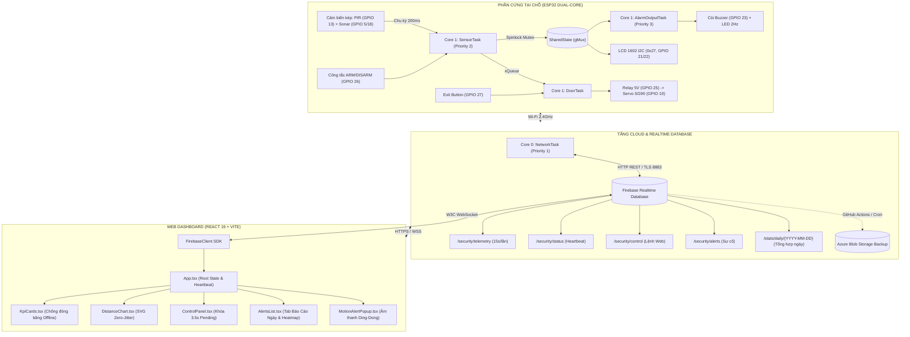

# HỆ THỐNG AN NINH & BÁO ĐỘNG ĐỘT NHẬP THÔNG MINH IOT (ESP32 DUAL-CORE & CLOUD REALTIME)

> **Tài Liệu Tổng Hợp Kiến Trúc Hệ Thống, Tổ Chức Dữ Liệu & Toàn Bộ Mã Nguồn Dự Án**  
> *Được chuẩn hóa theo kiến trúc FreeRTOS Dual-Core, Firebase Realtime Database, Cloud Cold-Path và React 19 Zero-Jitter Dashboard.*

---

## 1. TỔNG QUAN HỆ THỐNG & SƠ ĐỒ LUỒNG DỮ LIỆU (FLOW)

Hệ thống hoạt động theo mô hình **Hybrid IoT 3 tầng**:
1. **Edge Firmware (ESP32)**: Xử lý an ninh thời gian thực tại chỗ bằng 2 nhân (Core 0 & Core 1), đảm bảo hệ thống độc lập 100% (tự hú còi, khóa cửa, quét cảm biến ngay cả khi mất mạng Wi-Fi).
2. **Cloud Realtime Backend (Firebase Realtime Database & Azure Storage)**: Cầu nối thời gian thực (< 100ms) lưu trữ trạng thái, tiếp nhận lệnh điều khiển, thống kê lưu lượng theo ngày (`stats/daily`) và sao lưu định kỳ lên Azure Blob Storage.
3. **Web Dashboard (React 19 + TypeScript + Vite)**: Giao diện giám sát an ninh với biểu đồ SVG Zero-Jitter, bản đồ nhiệt 24 khung giờ (Heatmap), popup âm thanh Ding-Dong (Web Audio API) và cơ chế chống dữ liệu đóng băng khi thiết bị ngoại tuyến.



---

## 2. PHẦN CỨNG & SƠ ĐỒ CHÂN (PINOUT SPECIFICATION)

| STT | Thiết Bị / Module | Chân Linh Kiện | Chân GPIO ESP32 | Mức Logic / Quy Chuẩn Kỹ Thuật An Toàn |
| :---: | :--- | :--- | :---: | :--- |
| **1** | **PIR HC-SR501** | OUT | **GPIO 13** | Mức 3.3V Digital; bỏ qua 30s đầu (PIR Warm-up). |
| **2** | **HC-SR04 (Sonar)** | TRIG | **GPIO 5** | Xuất xung Trigger 10µs kích phát sóng siêu âm 40kHz. |
| **3** | **HC-SR04 (Sonar)** | ECHO (5V) | **GPIO 18** | **BẮT BUỘC QUA CẦU PHÂN ÁP 1kΩ / 2kΩ** hạ về 3.3V an toàn. |
| **4** | **Active Buzzer** | Cực dương (+) | **GPIO 23** | **NGHIÊM CẤM DÙNG GPIO 12** (Strapping pin gây treo nạp flash). |
| **5** | **LED Báo Động (Vàng/Đỏ)**| Anode (+) | **GPIO 32** (hoặc D2) | Qua trở 220Ω, chớp nháy tần số 2Hz khi ALARM. |
| **6** | **LED Trạng Thái (Xanh)** | Anode (+) | **GPIO 33** (hoặc D4) | Qua trở 220Ω, sáng liên tục khi ARMED, tắt khi DISARMED. |
| **7** | **Servo mini SG90** | Xung PWM (Cam) | **GPIO 19** | Góc 0° (Khóa chốt), 160° (Mở chốt). Nguồn 5V qua Relay. |
| **8** | **Module Relay 5V** | Chân IN | **GPIO 25** | Mức Active-LOW (Power-Gating ngắt nguồn 5V của Servo khi nghỉ). |
| **9** | **Nút Nhấn Exit** | 2 chân | **GPIO 27** | Kéo xuống GND; INPUT_PULLUP, chống rung 50ms, Exit Delay 10s. |
| **10**| **Công Tắc Chế Độ ARM** | 3 chân | **GPIO 26** | Chuyển trạng thái ARM / DISARM offline trực tiếp không cần mạng. |
| **11**| **Màn Hình LCD 1602** | SDA / SCL | **GPIO 21 / 22** | Giao tiếp phần cứng I2C (Địa chỉ 0x27), nguồn cấp 5V. |

---

## 3. MÃ NGUỒN FIRMWARE ESP32 (`src/main.cpp` & `include/Config.h`)

### 3.1. Cấu Hình Thông Số Hệ Thống (`include/Config.h`)
- Chân pinout, logic Relay Active-LOW, góc xoay Servo (0° - 160°).
- Ngưỡng khoảng cách mặc định `DEFAULT_DISTANCE_THRESHOLD_CM = 50cm` (ngưỡng nhạy 12cm).
- Chu kỳ FreeRTOS:
  - `PIR_WARMUP_MS = 30000ms` (30 giây khởi động cảm biến).
  - `ALARM_AUTO_SILENCE_MS = 10000ms` (Tự ngắt còi hú sau 10 giây nếu mục tiêu rời đi).
  - `AUTO_RELOCK_DELAY_MS = 2000ms` (Tự đóng chốt cửa sau 2 giây).
  - `EXIT_DELAY_MS = 10000ms` (Hoãn báo động 10 giây khi người nhà bấm Exit Button).
  - `SENSOR_INTERVAL_MS = 200ms` (Đọc cảm biến chu kỳ 200ms non-blocking).
  - `TELEMETRY_INTERVAL_MS = 15000ms` (Gửi telemetry mỗi 15 giây lên Cloud).

### 3.2. Cấu Trúc Dữ Liệu Đa Nhân & Spinlock Mutex
```cpp
struct SharedState {
    bool     armed = false;          // Trạng thái an ninh (Bật/Tắt)
    bool     alarm = false;          // Trạng thái còi hú
    bool     pir = false;            // Cảm biến hồng ngoại PIR
    bool     doorLocked = true;      // Trạng thái chốt khóa (Khóa/Mở)
    float    distanceCm = -1.0f;     // Cự ly siêu âm (cm)
    uint32_t alarmSinceMs = 0;       // Thời điểm bắt đầu báo động
    uint16_t thresholdCm = 12;       // Ngưỡng phát hiện đột nhập
    uint32_t autoRelockAtMs = 0;     // Hẹn giờ tự khóa chốt
    uint32_t exitDelayUntilMs = 0;   // Thời hạn hoãn báo động khi bấm Exit
};

static SharedState  g;
static portMUX_TYPE gMux = portMUX_INITIALIZER_UNLOCKED;

// Hàm lấy snapshot an toàn tuyệt đối qua spinlock siêu ngắn
static SharedState snapshot() {
    portENTER_CRITICAL(&gMux);
    SharedState s = g;
    portEXIT_CRITICAL(&gMux);
    return s;
}
```

### 3.3. Các Tác Vụ FreeRTOS Độc Lập
1. **`sensorTask` (Core 1, Priority 2)**:
   - Đọc cảm biến PIR và phát xung HC-SR04 mỗi 200ms bằng `millis()`.
   - Thuật toán phối hợp kép: Chỉ kích hoạt `alarm = true` khi:
     $$\text{armed} == \text{true} \;\land\; \text{now} \ge \text{exitDelayUntilMs} \;\land\; \text{pir} == \text{true} \;\land\; (0 < \text{dist} \le \text{thresholdCm})$$
   - Loại trừ 99% báo động giả do ánh nắng hoặc chuột bọ.
2. **`alarmOutputTask` (Core 1, Priority 3 - Cao nhất)**:
   - Nhấp nháy LED cảnh báo 2Hz và bật còi hú khi `s.alarm == true`.
   - Luôn nhường CPU bằng `vTaskDelay(pdMS_TO_TICKS(20))` khi yên tĩnh để không gây đói CPU (Starvation).
3. **`doorTask` (Core 1, Điều khiển chốt qua Queue & Power-Gating)**:
   - Lắng nghe lệnh từ `doorQueue`.
   - Bật Relay (GPIO 25 LOW) $\rightarrow$ Chờ 40ms ổn định nguồn $\rightarrow$ Xoay Servo góc đích $\rightarrow$ Chờ 550ms hoàn tất $\rightarrow$ Ngắt Relay (GPIO 25 HIGH) để chống nóng và rít rung cơ khí.
4. **`networkTask` (Core 0, Priority 1)**:
   - Tự động duy trì Wi-Fi Station `WIFI_STA`.
   - Gửi Telemetry chu kỳ 15s bằng HTTP REST Keep-Alive TLS.
   - Thăm dò (Poll) lệnh điều khiển `/security/control.json` từ Web Client mỗi 3s.

---

## 4. TỔ CHỨC CƠ SỞ DỮ LIỆU & BẢO MẬT (DATA SCHEMAS & RULES)

### 4.1. Cấu Trúc Cây Dữ Liệu Firebase Realtime Database
```text
/
├── security/
│   ├── status/                       # Trạng thái Online/Offline
│   │   ├── online: true/false
│   │   └── lastHeartbeat: 1731934800000
│   ├── telemetry/                    # Bản tin tức thời từ ESP32
│   │   ├── deviceId: "esp32-chongtrom-01"
│   │   ├── armed: true
│   │   ├── doorLocked: true
│   │   ├── alarm: false
│   │   ├── pir: false
│   │   ├── distanceCm: 16.6
│   │   ├── thresholdCm: 12
│   │   ├── ip: "192.168.1.18"
│   │   ├── rssi: -36
│   │   ├── uptimeS: 1250
│   │   └── ts: 1731934815000          # Epoch ms chuẩn UTC
│   ├── control/                      # Lệnh điều khiển từ Web Dashboard
│   │   ├── armed: true
│   │   ├── doorLocked: true
│   │   ├── silenceAlarm: false
│   │   └── timestamp: 1731934810000
│   ├── config/                       # Cài đặt ngưỡng lưu NVS Flash
│   │   ├── thresholdCm: 12
│   │   ├── autoRelockDelayMs: 2000
│   │   └── exitDelayMs: 10000
│   ├── schedule/                     # Lịch trình tự động theo giờ
│   │   ├── enabled: true
│   │   ├── armTime: "22:00"
│   │   └── disarmTime: "06:00"
│   ├── alerts/{alertId}/             # Nhật ký 100 sự cố đột nhập gần nhất
│   │   ├── deviceId: "esp32-chongtrom-01"
│   │   ├── sensor: "PIR+SONAR"
│   │   ├── distanceCm: 8.5
│   │   ├── doorLocked: true
│   │   └── timestamp: 1731934820000
│   └── audit/{logId}/                # Nhật ký thao tác của người dùng
│       ├── action: "ARM" | "DISARM" | "LOCK_DOOR" | "UNLOCK_DOOR"
│       ├── detail: "Kích hoạt an ninh từ Web"
│       ├── userEmail: "admin@gmail.com"
│       └── timestamp: 1731934805000
└── stats/
    └── daily/
        └── {YYYY-MM-DD}/              # Khóa ngày theo múi giờ Asia/Ho_Chi_Minh
            ├── total:                 # Tổng hợp cả ngày
            │   ├── passby: 45         # Số lượt người đi ngang
            │   ├── alert: 12          # Số vụ báo động đột nhập
            │   ├── pir: 8
            │   ├── sonar: 0
            │   └── both: 4
            └── hours/
                ├── "00": { passby: 1, alert: 0 }
                ├── ...
                └── "23": { passby: 3, alert: 1 }
```

### 4.2. Quy Tắc Bảo Mật (`database.rules.json`)
```json
{
  "rules": {
    "security": {
      ".read": "auth != null",
      ".write": "auth != null",
      "alerts": {
        ".indexOn": ["timestamp"]
      },
      "audit": {
        ".indexOn": ["timestamp"]
      }
    },
    "stats": {
      "daily": {
        ".read": "auth != null",
        ".write": "auth != null",
        ".indexOn": [".key"]
      }
    }
  }
}
```

### 4.3. Script Di Trú Dữ Liệu Lịch Sử (`scripts/migrate_stats.js`)
- Tự động quét toàn bộ 240 bản ghi sự cố lịch sử trong `/security/alerts`.
- Chuyển đổi timestamp sang múi giờ `Asia/Ho_Chi_Minh` (UTC+7).
- Tổng hợp vào node `/stats/daily/{YYYY-MM-DD}` theo đúng cấu trúc `total` và `hours/{00..23}`.

---

## 5. GIAO DIỆN WEB DASHBOARD (REACT 19 + TYPESCRIPT + VITE)

### 5.1. Cấu Trúc Mã Nguồn Frontend (`web/src/`)
- `App.tsx`: Quản lý toàn bộ vòng đời kết nối, bộ đếm nhịp tim Heartbeat, kiểm tra lịch trình tự động ARM/DISARM, và cơ chế phát hiện Offline.
- `lib/firebaseClient.ts`: Đóng gói SDK Firebase Realtime Database, giao dịch nguyên tử `runTransaction()` cho bộ đếm thống kê ngày, và dọn dẹp log cũ > 30 ngày.
- `components/Header.tsx`: Thanh điều hướng, nút Bật/Tắt chuông báo (Mute), nhãn trạng thái `LIVE (Xs trước)` hoặc `MẤT TÍN HIỆU (Xs trước)`, và thông tin đăng nhập.
- `components/KpiCards.tsx`: 6 thẻ chỉ số thời gian thực. **Đã xử lý triệt để lỗi dữ liệu đóng băng**: Khi thiết bị OFFLINE, tự động chuyển PIR và cự ly về trạng thái `"NGOẠI TUYẾN"` và `"-- cm"`.
- `components/ControlPanel.tsx`: Điều khiển tức thời ARM/DISARM, Khóa/Mở chốt với cơ chế **Pending Lock Ref 3.5s** chống click đúp.
- `components/DistanceChart.tsx`: Biểu đồ khoảng cách SVG Zero-Jitter chuẩn mực (CLS = 0, cố định banner tooltip 48px).
- `components/AlertsList.tsx`:
  - Tab 1: **Sự Cố Đột Nhập** (Lọc cảm biến, phân bố 24h, sửa lỗi đảo ngày, xuất CSV).
  - Tab 2: **Báo Cáo Theo Ngày** (Thẻ KPI so sánh % kỳ trước, biểu đồ cột Stacked + Trendline SVG, Heatmap Ngày × 24 Giờ, bảng sắp xếp, xuất CSV/PDF, nút dọn dẹp log cũ).
  - Tab 3: **Nhật Ký Thao Tác** (Lưu vết hành động của từng Quản trị viên).
- `components/MotionAlertPopup.tsx`: Popup toast phát âm thanh Ding-Dong (người đi ngang) hoặc Còi hú hai tầng (xâm nhập) qua Web Audio API thuần; tự động đóng và không bao giờ kích hoạt khi thiết bị OFFLINE.

---

## 6. KIỂM TRA LUỒNG HOẠT ĐỘNG TOÀN HỆ THỐNG (GRAPHIFY ANALYSIS)

Dựa trên phân tích cây phụ thuộc thực tế từ **Knowledge Graph (375 nodes, 662 edges, 17 communities)**:

```text
[Trục Trọng Tâm - God Nodes]:
FirebaseClient (25 edges) <==> App() (19 edges) <==> SharedState (14 edges) <==> TelemetryData (10 edges)
```

### Kịch Bản Vận Hành 1: Phát Hiện Người Đi Ngang (Chế Độ DISARMED)
1. Người bước qua khu vực quét: Cảm biến PIR (GPIO 13) kéo lên HIGH, HC-SR04 đo cự ly `16.6 cm`.
2. `sensorTask` (Core 1) cập nhật vào `SharedState`. Do `armed == false`, hệ thống **không hú còi**.
3. `networkTask` (Core 0) gửi bản tin Telemetry lên Firebase `/security/telemetry`.
4. Web Dashboard nhận qua WebSocket: `MotionAlertPopup` phát âm thanh Ding-Dong êm ái, popup hiển thị *"Phát hiện có người đi ngang qua (16.6 cm)"*.
5. Web Client gọi giao dịch nguyên tử `runTransaction()` tăng bộ đếm `stats/daily/{YYYY-MM-DD}/total/passby` và `hours/{HH}/passby`.

### Kịch Bản Vận Hành 2: Đột Nhập Nguy Hiểm (Chế Độ ARMED)
1. Kẻ gian áp sát cửa: PIR = HIGH và Sonar < 12cm.
2. `sensorTask` phát hiện vi phạm điều kiện an ninh $\rightarrow$ kích hoạt `alarm = true`.
3. `alarmOutputTask` (Core 1, Priority 3) lập tức kích còi Buzzer (GPIO 23) hú vang và nháy LED vàng 2Hz.
4. Chốt cửa Servo đóng chặt ở góc 0°.
5. Thông tin sự cố được đẩy vào `/security/alerts` và gửi bản tin khẩn cấp lên Web Dashboard: Web hú còi báo động hai tầng, popup đỏ rực, lưu vết nhật ký sự cố.

### Kịch Bản Vận Hành 3: Thoát Hiểm Khẩn Cấp (Exit Button)
1. Người nhà chuẩn bị ra ngoài: Bấm nút Exit Button (GPIO 27).
2. `doorTask` kích Relay mở chốt Servo sang 160°.
3. Hệ thống thiết lập cờ `exitDelayUntilMs = now + 10000ms` (hoãn báo động 10 giây).
4. Sau 2 giây, Servo tự động khóa chốt lại (0°) để bảo vệ cửa.
5. Người nhà có 8 giây còn lại để bước qua cửa mà không bị còi hú.

### Kịch Bản Vận Hành 4: Mất Nguồn / Ngắt Mạng (Offline Handling)
1. Kẻ gian cố tình cắt Wi-Fi hoặc ngắt nguồn nhà:
   - Nếu ngắt Wi-Fi: ESP32 vẫn tiếp tục bảo vệ an ninh tại chỗ, hú còi và khóa chốt bình thường.
   - Nếu ngắt nguồn ESP32: Web Dashboard đếm nhịp tim `elapsed > 15s` $\rightarrow$ Tự động chuyển huy hiệu sang **"MẤT TÍN HIỆU"**, chuyển các thẻ PIR/Sonar sang **"NGOẠI TUYẾN"**, ngăn chặn toàn bộ thông báo ảo và âm thanh rác.

---

## 7. HƯỚNG DẪN BIÊN DỊCH VÀ TRIỂN KHAI

### Firmware ESP32 (PlatformIO)
```powershell
# Biên dịch firmware
pio run

# Nạp firmware vào bo mạch ESP32
pio run -t upload

# Mở cổng Serial Monitor (115200 baud)
pio run -t monitor
```

### Web Dashboard (React 19 Vite) & Firebase
```powershell
cd web
npm install
npm run build

# Deploy Hosting và Database Rules
npx firebase-tools deploy --only database,hosting
```

---
*Bản quyền kiến trúc & tài liệu kỹ thuật: Đồ án Hệ Thống An Ninh Chống Trộm Thông Minh IoT ESP32 (2026).*
